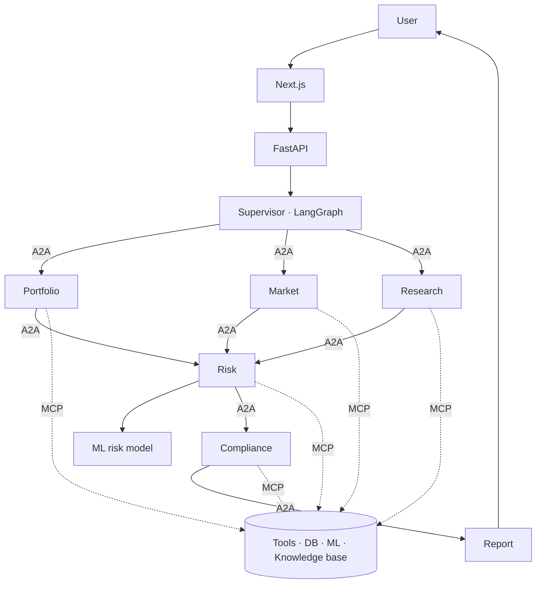

# FINAGENT — Finance Multi-Agent Intelligence Platform

AI-powered financial decision support that coordinates specialised agents, machine-learning
models, financial data and enterprise documents to automate **portfolio, risk, fraud, research and
compliance** analysis for an asset manager — with evidence, audit trails and human approval for
anything high-impact.

> **Decision support only — not investment advice.** Agents never execute trades; every proposed
> order is a draft that requires human approval.

**Status:** Stages 0–1 complete (foundation, database, seed). See [docs/PLAN.md](docs/PLAN.md) for progress.

## The problem

Portfolio, market, risk, fraud, research and compliance teams each pull data from different
systems, run their own analysis, read reports and write summaries by hand. Risks surface late,
evidence is scattered, and decisions are hard to audit.

## What FinAgent does

Ask one question — *"Why has the risk of our technology portfolio increased, and what are the major
contributors?"* — and the supervisor decides which data, agents, ML models, documents and checks
are needed, runs them in dependency order (in parallel where possible), and returns a report that
separates **FACT · ML PREDICTION · LLM INTERPRETATION · RECOMMENDATION · ASSUMPTION ·
UNCERTAINTY**, with citations.



| Layer | Purpose |
|---|---|
| **A2A** | Agent ↔ agent: structured envelopes with tracing, timeouts and retries |
| **MCP** | Agent → tools/data: six MCP servers (market, finance, risk, research, portfolio, ml) |
| **Knowledge base** | Agent → documents: bi-encoder + BM25 hybrid search, cross-encoder re-ranking, citations |
| **ML** | Fraud (LightGBM + Isolation Forest), risk scoring, forecasting — tracked in MLflow |

## Agents

Supervisor · Market · Portfolio · Risk · Fraud Detection · Research · Prediction · Compliance ·
Report. Specs in [docs/agents/](docs/agents/), playbooks in [skills/](skills/).

## Tech stack

Python 3.12 (uv) · FastAPI · LangChain · LangGraph · SQLAlchemy 2 async + psycopg3 · Alembic ·
Supabase Postgres + pgvector · Redis · LightGBM · scikit-learn · MLflow · MCP Python SDK ·
sentence-transformers (cross-encoder) · Next.js 16 · TypeScript · Tailwind 4 · shadcn/ui ·
Recharts · Docker · Kubernetes · Terraform (AWS) · GitHub Actions · Prometheus · Grafana ·
OpenTelemetry · LangSmith.

LLMs: EURI (primary) with Gemini and Groq fallbacks via OpenAI-compatible APIs; Anthropic and
Bedrock adapters available.

## Run it locally (question → multi-agent answer)

Prerequisites: [uv](https://docs.astral.sh/uv/), Node 22+, a filled-in `.env` at the repo root
(copy `.env.example`). The database is Supabase (already migrated and seeded for this project).

**1. Backend (terminal 1)**
```powershell
cd backend
uv sync                                        # first time only
uv run alembic upgrade head                    # first time only: tables + RLS + tenancy
uv run python -m scripts.seed                  # first time only: synthetic data (~40 s)
uv run python -m scripts.create_demo_users     # first time only: 8 demo users
uv run python -m scripts.train_models          # first time only: fraud/risk/forecast models (~8 min)
uv run python -m scripts.ml_check              # optional: call the ML tools (no LLM calls)
uv run python -m scripts.make_kb_samples       # first time only: sample documents (12 formats)
uv run python -m scripts.ingest_kb             # first time only: knowledge base (~12 embedding calls)
uv run python -m scripts.kb_ask "What is the 1-day 95% VaR budget?"   # grounded answer + citations
uv run python -m scripts.dev_server            # API → http://127.0.0.1:8020/docs
```

**2a. Ask from the terminal (terminal 2)**
```powershell
cd backend
uv run python -m scripts.ask "Why has the risk of our technology portfolio increased?"
uv run python -m scripts.ask "Check Portfolio A against our policy limits" --user compliance@northwind.example.com
```

**2b. Or use the web app (terminal 2)**
```powershell
cd frontend
npm install                                    # first time only
npm run dev                                    # → http://localhost:3020
```
Sign in as e.g. `risk@northwind.example.com` with the password in `DEMO_USER_PASSWORD` (`.env`).

| Demo user | Role | Firm (tenant) |
|---|---|---|
| risk@northwind.example.com | risk_manager | Northwind |
| pm@northwind.example.com | portfolio_manager | Northwind |
| compliance@northwind.example.com | compliance_officer | Northwind |
| analyst@northwind.example.com | analyst | Northwind |
| fraud@northwind.example.com | fraud_analyst | Northwind |
| viewer@northwind.example.com | viewer (cannot ask the agents) | Northwind |
| admin@northwind.example.com | admin | Northwind |
| pm@contoso.example.com | portfolio_manager | Contoso (sees only its own data) |

### Example questions and what to expect

| Question | Expected answer |
|---|---|
| Why has the risk of our technology portfolio increased, and what are the major contributors? | Portfolio A: risk HIGH (≈67/100); volatility ≈22.9% → 32.8% mostly from market moves; NVTK the top contributor (weight 26.2% → 31.0%); hard breach NVTK 31.0% vs 25%; approval required |
| Check Portfolio A against our policy limits | 1 hard breach (NVTK single-name) + 3 warnings (Semiconductors, Technology, 1-day VaR 2.52% vs 2.5%) |
| Give me a complete risk review of Portfolio B | Balanced portfolio, no breaches; MRDN drawdown visible in holdings |
| What is happening in the market this month? | Benchmark and sector moves plus cited (fictional) news |
| What is the best pizza topping? | Politely refused as out of scope |

Typical cost: ~8 LLM calls, ~6.5k tokens (≈$0.003) per full risk question, capped at 12k tokens
per request (ADR-029). Tests: `cd backend && uv run pytest -q`.

## Repository layout

```
backend/        Python backend: src/ (api, orchestration, agents, a2a, mcp, tools, services,
                ml, rag, guardrails, data, db, security, core, config, schemas, providers,
                container.py), tests/, scripts/, pyproject.toml, uv.lock, alembic.ini
skills/         domain playbooks used by agents
docs/           architecture, agent design, A2A, MCP, ML, RAG, security, deployment, API, testing
models/         trained ML artefacts (git-ignored binaries)
frontend/       Next.js app (Stage 9)
infrastructure/ terraform, docker, aws (Stage 11)
monitoring/     prometheus, grafana, dashboards (Stage 11)
```

## Documentation

| Doc | Contents |
|---|---|
| [PLAN.md](docs/PLAN.md) | Stages, status, acceptance criteria |
| [architecture-decisions.md](docs/architecture-decisions.md) | Every design decision and why |
| [architecture.md](docs/architecture.md) | System, layers, question flow |
| [agent-design.md](docs/agent-design.md) | Agent contract, plans, approval flow |
| [a2a-protocol.md](docs/a2a-protocol.md) | Envelope, retries, transports |
| [mcp-architecture.md](docs/mcp-architecture.md) | Servers, tools, authorization |
| [ml-architecture.md](docs/ml-architecture.md) | Fraud, risk, prediction, MLflow |
| [rag-architecture.md](docs/rag-architecture.md) | Loaders, 14 chunking strategies, hybrid search, re-ranking |
| [security.md](docs/security.md) | Auth, RBAC matrix, PII, audit |
| [api.md](docs/api.md) | Endpoints and status |
| [testing.md](docs/testing.md) | Test layout and required scenarios |
| [deployment.md](docs/deployment.md) | Local, Compose, AWS, CI/CD |

## Sample questions (available from Stage 7)

1. "Analyze my portfolio risk."
2. "Find suspicious transactions."
3. "Why is my portfolio risk increasing?"
4. "Compare Company A and Company B."
5. "Analyze the company's latest annual report."
6. "Predict fraud probability for transaction X."
7. "Generate an executive risk report."
8. "Explain the top contributors to portfolio risk."

## Limitations

All market, customer and transaction data is synthetic. Forecasts and fraud scores are model
estimates, not guarantees. Status of every component is tracked in [docs/PLAN.md](docs/PLAN.md).
