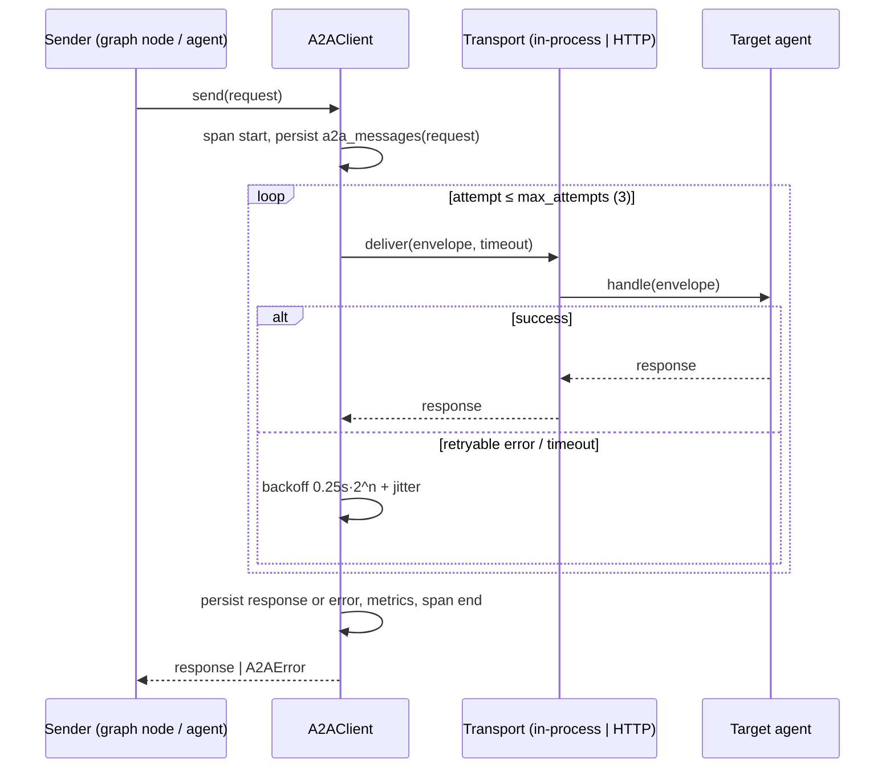

# A2A protocol

A2A = agent talks to agent. MCP = agent talks to tools and data. Agents never import each other's
Python modules; they exchange envelopes through `src/a2a`.

## Envelope

```json
{
  "message_id": "01J9Z4K2Q8...",
  "type": "request",
  "request_id": "req_6f1c...",
  "trace_id": "4bf92f3577b34da6a3ce929d0e0e4736",
  "correlation_id": "01J9Z4K2Q8...",
  "source_agent": "market_agent",
  "target_agent": "risk_agent",
  "task": "calculate_market_risk",
  "payload": {"portfolio_id": "PF-TECH-01", "horizon_days": 1},
  "context": {"user_id": "…", "role": "risk_manager", "upstream": ["portfolio_agent"]},
  "timestamp": "2026-10-08T05:31:04.120Z",
  "priority": "normal",
  "timeout_ms": 20000,
  "attempt": 1,
  "agent_metadata": {"version": "0.1.0", "capabilities": ["calculate_market_risk"]}
}
```

| Field | Meaning |
|---|---|
| `type` | `request`, `response` or `error` |
| `request_id` | The user request that started the run (also on audit rows) |
| `trace_id` | W3C trace id, propagated into OpenTelemetry spans and MCP calls |
| `correlation_id` | On a response/error: the `message_id` of the request it answers |
| `priority` | `low`, `normal`, `high` (queue ordering in the HTTP transport) |
| `timeout_ms` | Deadline the sender will wait; the receiver aborts work past it |
| `attempt` | Retry counter, starting at 1 |

Responses carry `payload` = the target agent's `AgentOutput`. Errors carry
`{"code": "...", "message": "...", "retryable": bool}` with codes `timeout`, `unavailable`,
`invalid_request`, `unauthorized`, `agent_failed`.

## Delivery semantics



- **Timeout:** per message (`timeout_ms`), enforced with `asyncio.timeout`.
- **Retry:** only for `timeout` and `unavailable`, max 3 attempts, exponential backoff with jitter.
  `invalid_request` and `unauthorized` are never retried.
- **Idempotency:** receivers dedupe on `message_id` within a run.
- **Authorization:** an agent may only send tasks listed in the target's agent card, and only with
  the user's role in `context` (agent authorization, base brief §23).
- **Persistence:** every envelope (payload summarised, PII redacted) goes to `a2a_messages`.
- **Metrics:** `a2a_messages_total{source,target,type}`, `a2a_latency_seconds{target}`,
  `a2a_retries_total{target}`.

## Transports

| Transport | Used for |
|---|---|
| In-process (default) | LangGraph nodes → agents in the same API process |
| HTTP (`src/a2a/server.py`) | Agents in separate containers or external A2A clients. `GET /.well-known/agent-card/{agent}` describes capabilities; `POST /a2a/{agent}` accepts an envelope. JWT required. |

Both transports run the same handler, so behaviour and tests are shared.
