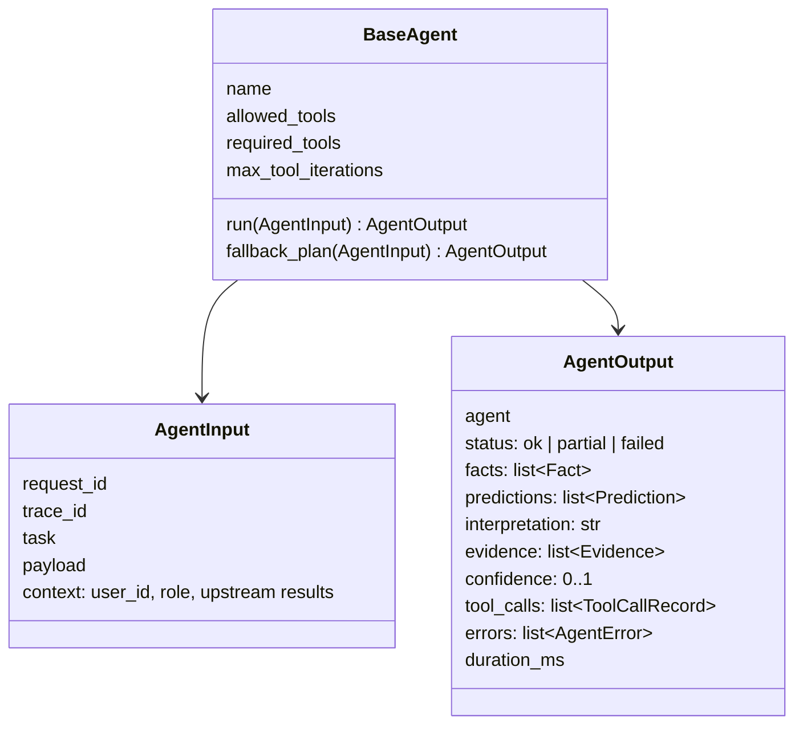
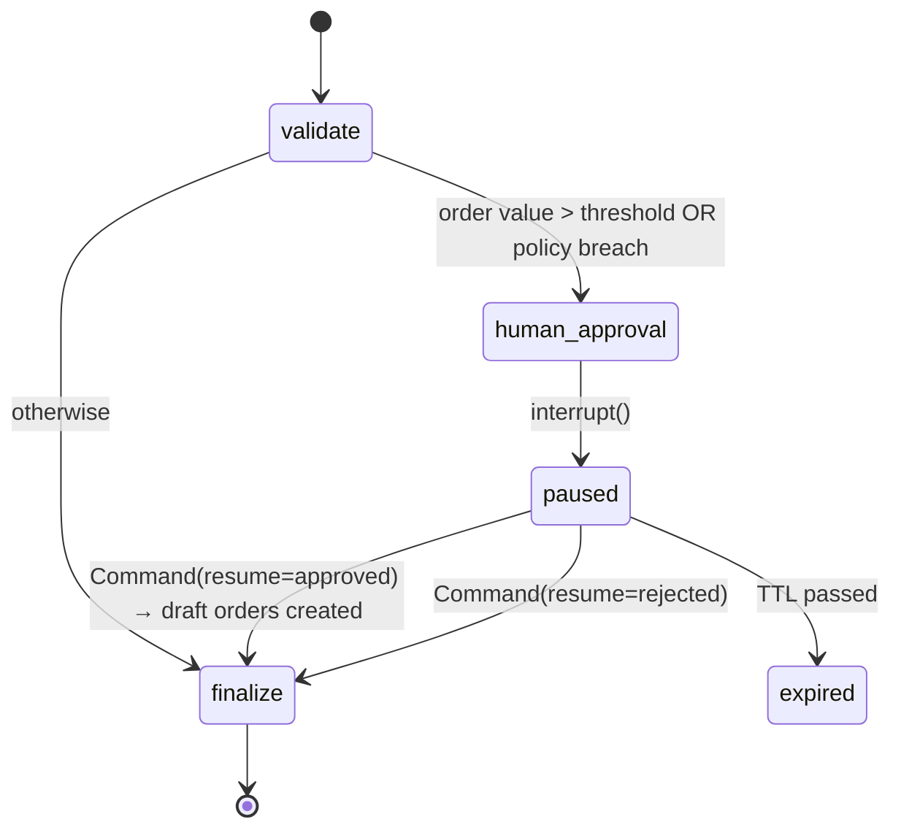

# Agent design

Nine agents. Per-agent specs: [docs/agents/](agents/). Domain playbooks the agents load:
[skills/](../skills/).

| Agent | Role | Main MCP servers | Output highlights |
|---|---|---|---|
| Supervisor | Intent, decomposition, plan, routing, failure handling, aggregation | — (A2A only) | intent, plan, aggregated results |
| Market | Prices, indicators, market summary, news | market | price stats, indicators, news with URLs |
| Portfolio | Holdings, allocation, returns, diversification, rebalance drafts | finance, portfolio | holdings, weights, returns, draft orders |
| Risk | VaR/CVaR, volatility, drawdown, beta, concentration, stress, ML risk score | risk, ml | risk metrics, limit status, risk score |
| Fraud | Suspicious payment transactions, fraud probability, anomaly | finance, ml | probability, risk level, reason codes |
| Research | Documents, filings, statements, news evidence | research | passages with citations |
| Prediction | Forecasts with intervals, never guaranteed | ml, market | prediction, interval, confidence, model version |
| Compliance | Policy limits, restricted lists, advice-language checks, approval need | risk, research | pass/flag/block + reasons, approval_required |
| Report | Deterministic executive report from facts | — | sectioned report (FACT … UNCERTAINTY) |

## Common contract

Each agent folder holds `agent.py` (the `BaseAgent` subclass), `prompts.py`
(role-based `ChatPromptTemplate`: system + user, with a permissions block built from the user's
role), `schemas.py` (structured input/output) and `tools.py` (the MCP tools it may call).

## Execution rules

1. **Bounded tool loop.** At most `max_tool_iterations` (default 4) model ↔ tool rounds.
2. **Required tools.** After the loop, any required tool the model skipped is called directly.
3. **Deterministic fallback.** If every LLM in the agent chain is down, the agent runs its
   `fallback_plan` (fixed tool sequence) and returns facts without narrative.
4. **Numbers come from tools.** The LLM never computes financial metrics. Narrative is validated
   against tool facts (Stage 6 guardrails).
5. **Confidence.** Computed, not asked of the LLM: required tools succeeded, data coverage, model
   confidence, fallbacks used.
6. **Read-only.** Agents never write orders. Portfolio can *propose* a rebalance; the graph turns it
   into an approval; only approved approvals create **draft** orders.
7. **No cross-imports.** Agents talk only through A2A envelopes.
8. **Observability.** Each run logs start/end, records an `agent_runs` row, a span with the
   request's `trace_id`, latency and token metrics.

## Supervisor plans

Plans are lists of stages; agents inside a stage run in parallel.

| Intent | Plan |
|---|---|
| `portfolio_risk` | [[portfolio, market, research], [risk], [compliance], [report]] |
| `risk_increase_explanation` | [[portfolio, market, research], [risk, prediction], [compliance], [report]] |
| `fraud_detection` | [[fraud], [compliance], [report]] |
| `fraud_prediction` | [[fraud], [report]] |
| `company_analysis` | [[market, research], [prediction], [compliance], [report]] |
| `company_comparison` | [[market, research], [compliance], [report]] |
| `document_analysis` | [[research], [compliance], [report]] |
| `executive_report` | [[portfolio, market, research, fraud], [risk, prediction], [compliance], [report]] |
| `rebalance` | [[portfolio], [risk], [compliance], [report]] |
| `knowledge_question` | [[research], [report]] — default for in-scope finance questions without a specific intent |
| `out_of_scope` | refuse politely, no agents |

Stage join is data-aware: if an upstream agent returned no holdings, risk is skipped with an
UNCERTAINTY note rather than run on empty data.

## Human approval

Approvals are idempotent (keyed by run + proposal hash), atomic, and only `portfolio_manager` or
`compliance_officer` can decide.
