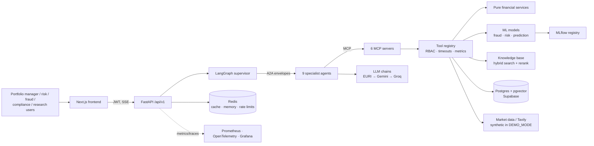
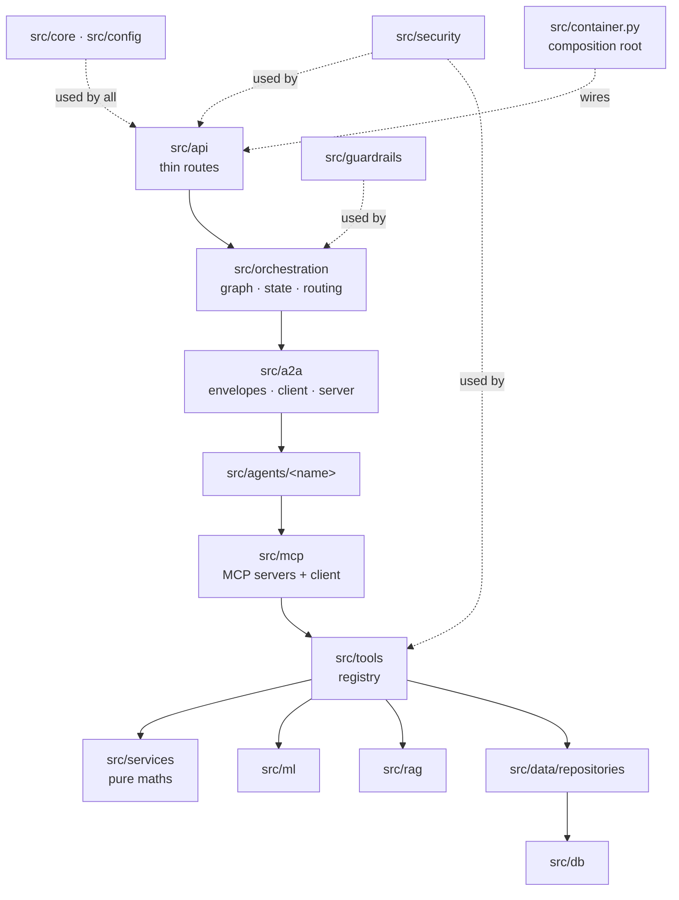
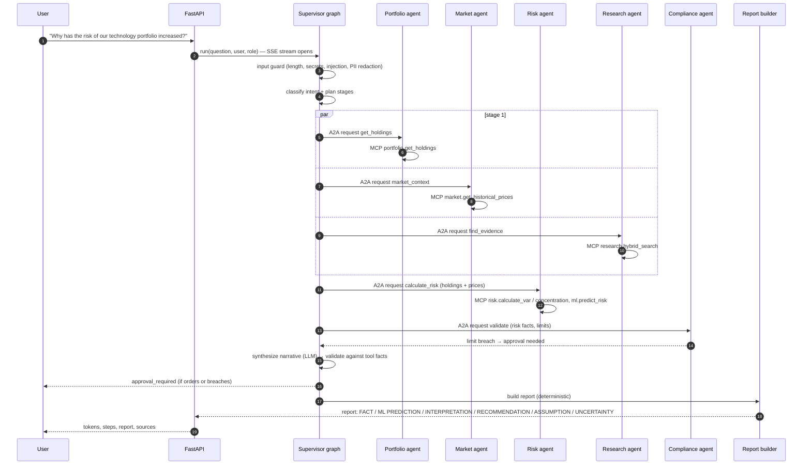

# FinAgent architecture

FinAgent is a decision-support platform for an asset manager's portfolio, risk, fraud, research
and compliance teams. A user asks one question; a supervisor decides which specialist agents,
ML models, documents and checks are needed, runs them in dependency order, and returns an
evidence-based, auditable answer. High-impact actions stop for human approval.

> Not investment advice. Agents never execute trades; every proposed order is a draft that needs
> human approval.

Decisions and trade-offs: [architecture-decisions.md](architecture-decisions.md). Delivery plan:
[PLAN.md](PLAN.md).

## System context

## Layers and dependency rules

Rules (enforced by `tests/architecture/test_architecture.py`):

| Rule | Why |
|---|---|
| Provider SDKs (`openai`, `langchain_openai`, `langchain_anthropic`, `langchain_aws`, `redis`, `tavily`, OCR) only in `src/container.py` and `src/rag/providers.py` | Providers swap by config; tests use fakes |
| SQL drivers, SQLAlchemy and raw SQL only in `src/db/` and `src/data/` | One place to review queries, RLS and performance |
| `src/services/` imports no frameworks, I/O, LLMs or other layers | Financial maths is pure, deterministic, unit-testable |
| `src/api/` never imports `src/db` | Routes stay thin |
| `src/agents/<a>` never imports `src/agents/<b>` | Agents talk only through A2A |
| Every route depends on `require_user` / `require_role(...)` unless listed as public with a reason | No accidental open endpoints |
| Every `APIRouter` has `prefix=` | Consistent URL space |
| Text I/O passes `encoding=` | Windows defaults to cp1252 |
| No secrets in tracked files | Keys live only in `.env` / secret stores |

## Question flow

## Answer structure

Every report separates:

| Section | Source |
|---|---|
| **FACT** | Tool results (database, pure services). Numbers appear exactly as computed. |
| **ML PREDICTION** | ML MCP tools, with model version, confidence and interval. |
| **LLM INTERPRETATION** | Narrative, validated: every number and ticker must appear in the facts. |
| **RECOMMENDATION** | Draft actions only; orders require approval. |
| **ASSUMPTION** | Inputs the system assumed (horizon, confidence level, missing data). |
| **UNCERTAINTY** | Data gaps, model limits, failed agents, fallbacks used. |

## Data stores

| Store | Holds |
|---|---|
| Postgres (Supabase) | Reference and market data, portfolios, payment transactions, ML outputs, documents + chunks (pgvector), agent runs, A2A messages, MCP calls, approvals, audit log, LangGraph checkpoints |
| Redis | Read-model cache (stale-while-revalidate), short-term conversation memory, rate limits, temporary agent state, locks |
| MLflow | Experiments, metrics, model artefacts, model registry |

## Resilience

Every external call has a timeout, retries with exponential backoff, a circuit breaker
(per `provider:model` for LLMs), and maps to the error taxonomy: quota/rate limit → 429, provider
error → 502, unreachable → 503. Errors return a request ID, never a stack trace. Exceptions are
never swallowed silently: they are logged with context and either surfaced or converted into a
typed error result.

## Deployment

See [deployment.md](deployment.md). Local: `uv run` + Supabase, or `docker compose up` with a
local Postgres. Cloud: AWS ap-southeast-1 (EKS, ECR, ElastiCache, OpenSearch, S3, Secrets
Manager, CloudWatch), Terraform validated only until the owner asks to apply.
