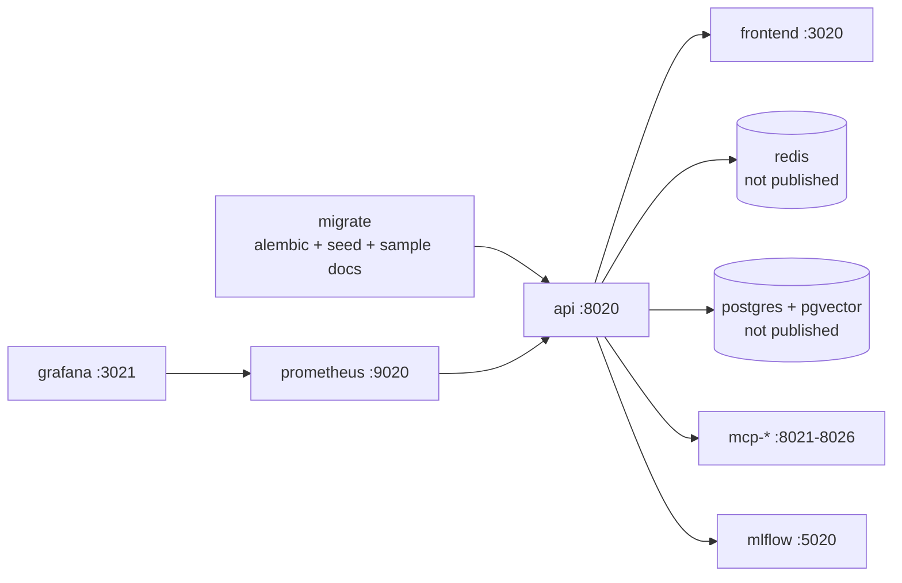
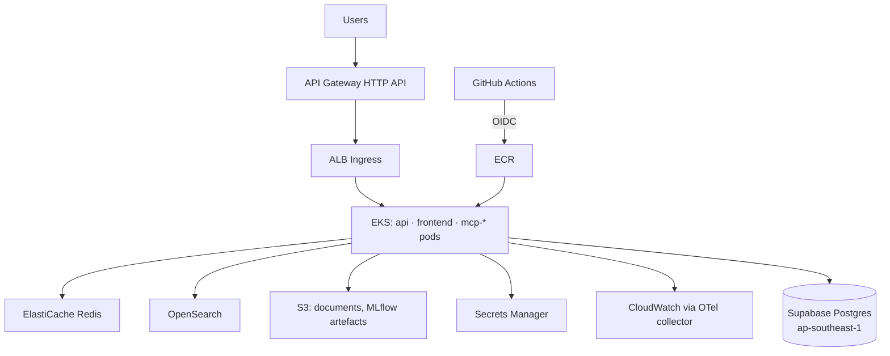

# Deployment

Status: local development works from Stage 0; Docker, Kubernetes, Terraform and CI/CD arrive in
Stage 11. Nothing is created in AWS unless the owner explicitly asks (`terraform apply`, image
pushes and cloud CLI writes are never run automatically).

## Local (uv + Supabase)

```bash
uv sync                                  # Python 3.12 venv from uv.lock
cp .env.example .env                     # fill in keys
uv run alembic upgrade head              # Stage 1, runs on the session pooler (5432)
uv run python -m scripts.seed            # Stage 1, idempotent
uv run python -m scripts.dev_server      # API on http://localhost:8020 (Windows-safe event loop)
```

## Docker Compose (Stage 11)



`docker compose up` starts the full stack offline with a local Postgres (ADR-004). Set
`DATABASE_TARGET=supabase` to use Supabase instead. Profiles: `monitoring` (Prometheus, Grafana),
`qdrant`. Hardening: non-root uid 10001, `read_only`, tmpfs `/tmp`, `cap_drop: ALL`,
`no-new-privileges`, one uvicorn worker per container, HEALTHCHECKs.

## AWS (Stage 11, region ap-southeast-1)



Terraform modules: VPC, EKS, ECR, GitHub OIDC role, S3, ElastiCache, OpenSearch, Secrets Manager,
CloudWatch, API Gateway, RDS (disabled by default). Kubernetes: Deployment, Service, Ingress (ALB),
HPA, PDB, NetworkPolicies, ServiceMonitor, ConfigMap; secrets injected by CD.

## CI/CD (Stage 11)

Lint → type check → unit tests → integration tests → security scan (Trivy, secret scan) → Docker
build → smoke test → push ECR → deploy EKS. Path filters when the repo holds several projects.

## Known pitfalls

- Supabase transaction pooler (6543) breaks prepared statements → `prepare_threshold=None`.
  Migrations and the LangGraph checkpointer use the session pooler (5432).
- Windows: async psycopg needs the Selector event loop policy in scripts and the dev server.
- Docker Desktop can freeze; restart it (or `wsl --shutdown`) before building.
- Local ports clash: use 8020/3020 etc.; never publish Redis.
