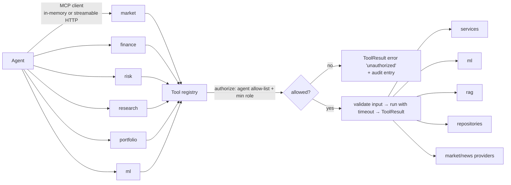

# MCP architecture

Tools are defined once in `src/tools` and served to agents (and external MCP clients) by six MCP
servers built with the official MCP Python SDK.



## Tool contract

```python
class ToolResult(BaseModel):
    ok: bool
    data: dict | list | None
    error: ToolError | None  # code, message, retryable
    tool: str
    duration_ms: float
    source: str  # e.g. "db", "synthetic", "ml:fraud@3", "tavily"
```

Every tool: pydantic-validated input (ticker `^[A-Z][A-Z0-9.\-]{0,9}$`, portfolio id
`^PF-[A-Z0-9\-]{2,20}$`, bounded ranges), a timeout, metrics
(`tool_calls_total{tool,status}`, `tool_latency_seconds{tool}`), a row in `mcp_tool_calls`, and
an audit entry when denied. Malformed tool output is caught and returned as
`ToolResult(ok=False, error=malformed_output)`.

## Servers and tools

| Server | Tools |
|---|---|
| **market** | `get_stock_price`, `get_historical_prices`, `get_company_financials`, `get_market_news`, `get_technical_indicators`, `get_market_summary`, `get_benchmark` |
| **finance** | `get_customer_profile`, `get_transactions`, `get_account_balance`, `get_portfolio`, `get_holdings`, `get_transaction_history`, `get_trades` |
| **risk** | `calculate_var`, `calculate_cvar`, `calculate_volatility`, `calculate_sharpe_ratio`, `calculate_max_drawdown`, `calculate_beta`, `calculate_risk_score`, `detect_anomaly`, `calculate_concentration_risk`, `check_policy_limits`, `stress_test` |
| **research** | `search_documents`, `search_financial_reports`, `search_news`, `vector_search`, `hybrid_search`, `rerank_documents`, `get_ratios`, `valuation_dcf` |
| **portfolio** | `calculate_returns`, `calculate_portfolio_risk`, `calculate_sharpe_ratio`, `calculate_drawdown`, `calculate_allocation`, `calculate_diversification`, `optimize_portfolio`, `propose_rebalance` (draft only), `get_portfolio_summary` |
| **ml** | `predict_fraud`, `predict_risk`, `predict_market_trend`, `predict_financial_metric` |

Base-brief tools are listed first; Build-spec tools (`get_benchmark`, `calculate_beta`,
`check_policy_limits`, `stress_test`, `get_ratios`, `valuation_dcf`, `propose_rebalance`,
`get_portfolio_summary`, `get_trades`) are added where they belong.

## Providers

Market data and news sit behind provider interfaces (`MarketDataProvider`, `NewsProvider`).
`DEMO_MODE=true` uses synthetic providers seeded from the database; Tavily backs `search_news`
when a key is configured. Real market APIs (Alpha Vantage, Polygon) plug in as new adapters
without touching tools or agents.

## Transports and auth

- **In-memory** (default): the agent's MCP client talks to the server object in the same process.
- **Streamable HTTP**: each server runs as its own container (ports 8021–8026). Requests carry the
  user's JWT; the server verifies it and passes `user_id`, `role` and calling `agent` to the
  registry. MCP authorization therefore equals tool authorization.

## Implementation status (Stage 3)

| Server | Tools live now |
|---|---|
| market | get_stock_price, get_historical_prices, get_company_financials, get_market_news, get_technical_indicators, get_market_summary, get_benchmark, search_instruments, search_news |
| finance | list_portfolios, get_portfolio, get_holdings, get_trades, get_customer_profile, get_account_balance, get_transactions, get_transaction_history |
| risk | calculate_var, calculate_cvar, calculate_volatility, calculate_sharpe_ratio, calculate_max_drawdown, calculate_beta, calculate_concentration_risk, check_policy_limits, stress_test, explain_risk_change, calculate_risk_score (rules-v1), detect_anomaly (z-score) |
| research | get_ratios, valuation_dcf, search_news (document search arrives with RAG, Stage 5) |
| portfolio | calculate_returns, calculate_portfolio_risk, calculate_sharpe_ratio, calculate_drawdown, calculate_allocation, calculate_diversification, optimize_portfolio, propose_rebalance (DRAFT), get_portfolio_summary |
| ml | (Stage 4) |

Every call carries `tenant_id`, `role`, `agent`, `request_id`, `trace_id` in MCP `_meta`
(`ToolContext.to_meta`). Implementation: `src/mcp/server_factory.py` (MCP SDK 2.x `MCPServer`),
gateway `src/mcp/client.py`.
