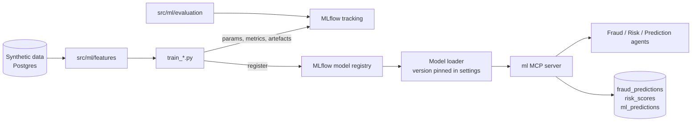

# ML architecture

ML models are separate from the LLM. They are trained offline on synthetic data, tracked in
MLflow, and served through the `ml` MCP server. Agents read their outputs as facts with a model
version and confidence; the LLM never produces the numbers.



## A. Fraud detection

| Item | Choice |
|---|---|
| Data | ~50k synthetic payment transactions, ~1.5% labelled fraud with realistic patterns (card testing, account takeover, unusual geography/device, velocity bursts) |
| Features | amount (raw, log, z-score vs customer history), transaction frequency (1h/24h/7d), merchant category, location distance from home, new device, historical behaviour (mean/std spend), account age, velocity |
| Models | LightGBM classifier (class weights) + Isolation Forest anomaly score as an extra feature and a standalone signal |
| Split | Time-based (train on earlier months, test on later) to avoid leakage |
| Metrics | Precision, recall, F1, PR-AUC, ROC-AUC, precision@k; threshold chosen for a target recall |
| Reason codes | Top positive LightGBM contributions (`pred_contrib`) mapped to codes: `unusual_amount`, `velocity_anomaly`, `new_device`, `geo_mismatch`, `merchant_risk`, `young_account`, `behaviour_shift` |

Output:

```json
{"fraud_probability": 0.87, "risk_level": "HIGH", "anomaly_score": 0.71,
 "reason_codes": ["unusual_amount", "velocity_anomaly"], "model_version": "fraud-lgbm@3"}
```

## B. Risk scoring

Features: volatility, concentration (top-1, HHI, sector max), max drawdown, gross exposure,
historical return, asset-class mix, market regime (benchmark volatility percentile). Labels come
from forward realised volatility/drawdown on synthetic history. LightGBM → `risk_score` (0–100),
`risk_category` (LOW/MEDIUM/HIGH/CRITICAL), `confidence` (from prediction spread across bagged
models), `feature_importance` (per-prediction contributions).

## C. Financial prediction

Target: next-period return or realised volatility for an instrument, or a financial metric
(revenue growth). LightGBM quantile regression (q = 0.1, 0.5, 0.9) on lagged features gives the
point forecast and `prediction_interval`; a naive/EWMA baseline and walk-forward backtest are
logged next to it. If the model does not beat the baseline, the tool says so in `uncertainty`.
Every output carries: "Forecasts are estimates, not guarantees."

## MLflow

- Experiments: `finagent-fraud`, `finagent-risk`, `finagent-prediction`.
- Logged: parameters, metrics, feature list, data hash, confusion matrix/PR curve images, model.
- Registry: models registered as `fraud-lgbm`, `risk-lgbm`, `forecast-lgbm`; serving loads a pinned
  version (`ML_FRAUD_MODEL_VERSION` etc.), recorded on every prediction row and audit entry.
- Local: file store under `mlruns/`; Compose: MLflow server on port 5020.

## Monitoring

`ml_inference_latency_seconds{model}`, `ml_predictions_total{model,label}`, drift via population
stability index on key features (scheduled job), fraud precision/recall from analyst feedback.
