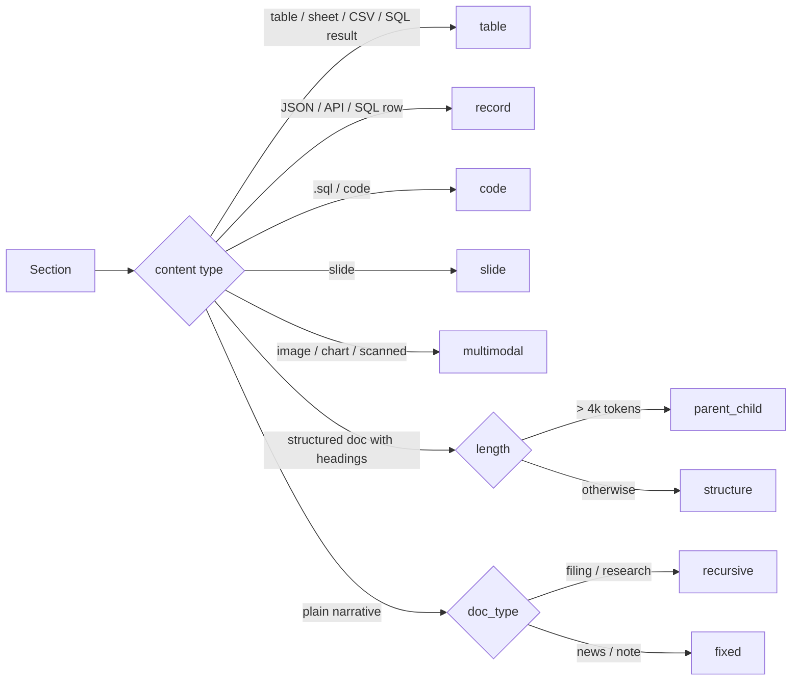

# RAG architecture

The knowledge base gives agents trusted, citable evidence from filings, statements, policies,
regulations and research.

```mermaid
flowchart TB
    subgraph Ingestion
      F[Files: PDF · XLSX · DOCX · PPTX · CSV · TXT/MD/JSON · images] --> L[Loaders<br/>+ OCR for scanned pages]
      L --> MD[Metadata extraction<br/>doc_type · ticker · fiscal_period ·<br/>classification · effective/expiry]
      MD --> N[Normalise CRLF→LF, hash]
      N -->|same hash| UN[status: unchanged<br/>no embedding calls]
      N -->|new/changed| CH[Chunking<br/>fixed · recursive · semantic · parent_child · table]
      CH --> E[Embeddings<br/>EMBEDDING_PROVIDER]
      E --> VS[(document_chunks<br/>vector(1536) HNSW + tsvector GIN)]
    end
    subgraph Retrieval
      Q[Query + user role] --> PF[SQL pre-filters<br/>+ mandatory classification filter]
      PF --> V[Bi-encoder vector search<br/>pgvector cosine]
      PF --> K[Full-text search<br/>BM25-style IDF]
      V & K --> RRF[RRF fusion · dedupe · parent collapse]
      RRF --> RR[Cross-encoder re-ranker<br/>~12 → top-k · LLM fallback]
      RR --> CF[Context filtering<br/>fence as untrusted · drop instructions · redact PII]
      CF --> LLM[Grounded answer<br/>citations on every factual sentence]
    end
```

## Knowledge domains

| Domain | Examples | `doc_type` |
|---|---|---|
| Financial | Annual/quarterly reports, statements, 10-K-style filings | `filing`, `statement` |
| Business | Products, processes | `internal` |
| Compliance | Regulations, investment policy, restricted lists | `policy`, `regulation` |
| Risk | Risk framework, methodologies, limits | `policy` |
| Research | Analyst and industry reports, news | `research`, `news` |

## Retrieved item

Every hit carries `document_id`, `source` (file name), `page` (or sheet/slide), `chunk_id`,
`timestamp` (ingested at), `relevance_score`, plus `doc_type`, `ticker`, `fiscal_period`.
Citations render as `10-K_ACME.pdf, p. 47` or `statements.xlsx, sheet Income`.

## Sources and loaders

Every source becomes a list of **sections** (text + structure + location) before chunking, so all
strategies work on any source. One bad file never fails the others; each gets its own status.

| Source | Loader | Section unit | Location in citation |
|---|---|---|---|
| PDF (text) | pypdf | page, with heading detection | `file, p. N` |
| PDF (scanned pages) | pdfium render → Tesseract OCR (vision-LLM option) | page | `file, p. N (OCR)` |
| DOCX | python-docx | heading-delimited section; tables kept whole | `file, section "Title"` |
| XLSX | openpyxl (values, not formulas) | sheet → markdown table | `file, sheet Name, rows a–b` |
| CSV / TSV | csv | table | `file, rows a–b` |
| PPTX | python-pptx | slide (text, tables, speaker notes, images) | `file, slide N` |
| Images (PNG/JPG/TIFF) | OCR + optional vision-LLM caption | image | `file (image)` |
| HTML / web pages | trafilatura-style boilerplate removal → headings | heading section | URL + heading |
| Web search (Tavily) | results + page fetch → HTML loader | result / heading section | URL, retrieved date |
| Markdown / TXT | text | heading section / paragraph | `file, section` |
| JSON / XML | parser | record (object / element) | `file, path $.items[3]` |
| REST API responses | API connector (JSON) | record | `api:<name>, id` |
| SQL query results | read-only repository query | row / row group | `sql:<view>, key` |
| `.sql` files | sqlparse | statement | `file, statement N` |
| Email (`.eml`) | email parser | message / thread; attachments routed to their loaders | `file, message` |

Rejected with a clear message: `.xls`, `.doc`, `.ppt` (legacy binary formats — save as
.xlsx/.docx/.pptx), password-protected files, files over the size limit.

## Chunking strategies

All sizes are in tokens (tiktoken `cl100k_base`). Metadata (document id, source, location,
doc_type, ticker, fiscal_period, classification, dates, section path) is preserved on every chunk.
Chunk ids are deterministic: `sha256(document_id, strategy, location, ordinal)`.

| Strategy | How it splits | Typical use | Defaults |
|---|---|---|---|
| `fixed` | Fixed token windows | Short notes, news snippets, logs | 400, overlap 15% |
| `sliding_window` | Fixed windows with large overlap | Dense text where facts straddle boundaries | 300, overlap 50% |
| `recursive` | Paragraph → sentence → word separators until under size | Narrative filings, research | 800, overlap 15% |
| `sentence_window` | One sentence per chunk for retrieval; ±k neighbours returned as context | Precise fact lookup in long reports | k = 3 |
| `semantic` | Breakpoints where bi-encoder similarity between adjacent sentences drops (percentile threshold) | Mixed-topic documents | 200–1200, 95th pct |
| `structure` (heading-aware) | Follows the document's own headings/sections (DOCX, HTML, Markdown, PDF headings); oversize sections fall back to `recursive` | Policies, regulations, 10-K items | section, max 1200 |
| `parent_child` | Large parent sections; small child chunks are embedded; search hits children, answer gets the parent | Long policies and annual reports | parent 2000, child 400, child overlap 10% |
| `hierarchical` | Three levels (document summary → section → paragraph), each embedded; retrieval can match at any level | Very long filings | summary ≤ 300 |
| `table` | One table per chunk; large tables split by row groups with the **header repeated**; a one-line natural-language caption added | XLSX, CSV, DOCX/PDF/PPTX tables, SQL results | row group by token budget |
| `record` | One JSON object / XML element / API record / SQL row per chunk, flattened to `key: value` lines | APIs, JSON, SQL rows | 1 record, merged if tiny |
| `code` | Statement/function boundaries (SQL statements, scripts) | `.sql` files, query libraries | 1 statement |
| `slide` | One slide per chunk: title + text + tables + speaker notes | PPTX | 1 slide |
| `multimodal` | Images, charts and scanned regions become chunks of OCR text **plus** a vision-LLM caption, linked to their page/slide and to the surrounding text chunk | Charts in reports, scanned statements, slide images | 1 figure |
| `proposition` | LLM rewrites text into self-contained factual statements | High-value policy text (opt-in; spends LLM quota) | off by default |

**Contextual headers.** Before embedding, every chunk is prefixed with a short header —
document title, doc_type, ticker, period and section path (e.g.
`ACME 10-K FY2025 › Item 7 MD&A › Liquidity`) — so a chunk keeps its meaning out of context.
The header is embedded and indexed but shown separately in citations.

### Strategy selection

`CHUNKING_STRATEGY=auto` (default) chooses per section:



Any strategy can be forced per upload (`strategy=` on the API) or per doc_type in settings.
The chunker is evaluated in Stage 10 (Recall@k, MRR per strategy) so defaults are measured, not
assumed.

## Search details

- Vector: pgvector HNSW (`vector_cosine_ops`). Full text: generated `tsvector`, GIN index, IDF
  weighting so rare tokens (tickers, CUSIPs) outweigh common words.
- Fusion: reciprocal rank fusion (k = 60), dedupe by content hash, parent collapse.
- **Bi-encoder** (embedding model) for recall: query and chunks embedded independently, cosine
  similarity in pgvector.
- **Cross-encoder** for precision: `BAAI/bge-reranker-base` scores each (query, passage) pair
  jointly, ~12 candidates → top-k. Runs locally on CPU (no LLM quota). `RERANKER=cross_encoder`
  (default) | `llm` | `none`; fallback cross-encoder → LLM → fused order.
- Vector store adapters: pgvector (default), Qdrant, OpenSearch (ADR-005).

## Grounded answers

Documents only; `[n]` on every factual sentence; numbers copied exactly; fixed refusal sentence
when evidence is missing: *"I can't answer that from the documents in the knowledge base."*;
answer cache keyed by `(question, filters, kb_version)`.

## Evaluation

Golden Q&A with evidence quotes verified verbatim against the sample documents; Recall@k, MRR,
source hit, faithfulness, answer relevancy, context precision/recall (Stage 10).
