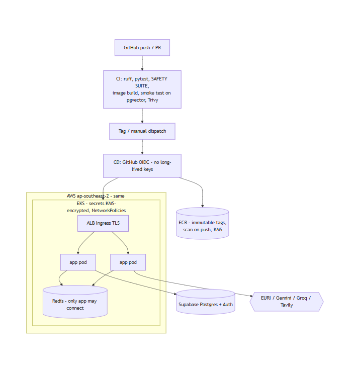

# 12 - AWS Deployment Plan

> Status: **Planned.** Terraform is written and passes `terraform validate`; it has **never been applied**.
> Kubernetes manifests render with `kubectl kustomize`; nothing has been deployed. Applying requires the
> owner's explicit approval.

## Target
Region **ap-southeast-2** (same as the Supabase database: latency and data residency together).

| Layer | Resource (infra/terraform) |
|---|---|
| Network | VPC (3 AZs, private/public subnets, NAT per AZ, flow logs) |
| Compute | EKS (managed node group, IMDSv2, encrypted gp3 volumes), VPC CNI with NetworkPolicy, CoreDNS, kube-proxy, EBS CSI |
| Secrets | KMS envelope encryption of Kubernetes Secrets |
| Images | ECR `medinfo-backend`, `medinfo-frontend` (immutable tags, scan on push, KMS, lifecycle 30) |
| CI/CD identity | GitHub OIDC provider + role scoped to `repo:<owner>/<repo>:environment:production`; namespace-scoped EKS edit |
| Ingress | AWS Load Balancer Controller (IRSA role created; controller installed by ops), ACM TLS |

## Kubernetes (deploy/k8s)
Namespace with Pod Security "restricted"; frontend (2-4 replicas) and backend (2-8) Deployments with
HPA + PDB; Redis (no persistence); default-deny NetworkPolicies; ServiceMonitor; secrets created by CD.

## Rollout steps (when approved)
1. Remote Terraform state (S3 + locking), set `github_repository`, `terraform plan` reviewed, then apply.
2. Install AWS Load Balancer Controller and kube-prometheus-stack; request ACM certificate.
3. Create GitHub environment `production` (required reviewers) with vars/secrets listed in `cd.yml`.
4. Tag a release -> CD: gate (tests + safety) -> build/push -> Trivy -> secrets -> `kubectl apply -k` -> rollout.
5. Run `db_init.py` against the production database; ingest approved, licensed sources only.
6. Smoke test, then live safety evaluation before any user access.

## Before real users (not optional)
Clinician sign-off of red-flag rules; licensed real sources; provider DPAs for PHI; region-specific
emergency/crisis numbers; penetration test; a documented clinical evaluation before any accuracy claim.
