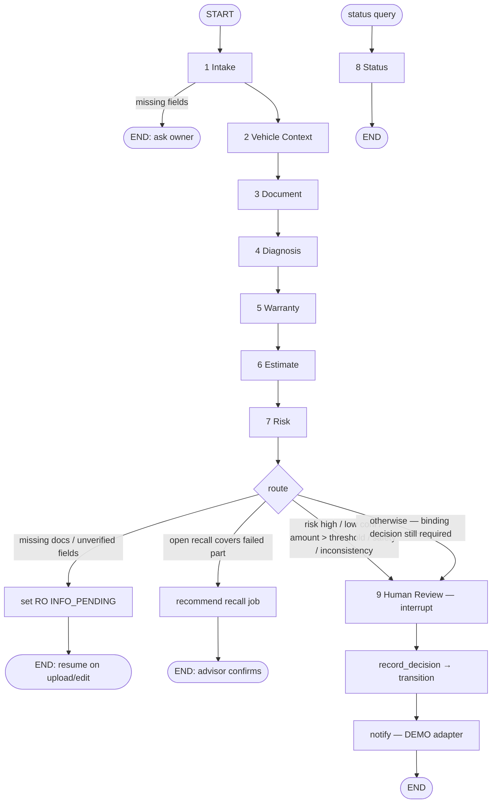

# Spec — ServiceGraphState

> Lives in `autoserve-server/app/graph/state.py`. Every node returns a partial dict containing **only the fields it owns**.
> Field types are Pydantic models (in `app/schemas/graph.py`) stored as dicts in state for checkpoint serialisation.

## TypedDict

```python
from typing import Annotated, Literal, TypedDict
import operator

class ServiceGraphState(TypedDict, total=False):
    # ── Identity / context (set by the API layer when the thread starts; read-only for nodes) ──
    thread_id: str                      # "ro:{ro_id}" or "claim:{claim_id}"
    ro_id: str | None
    claim_id: str | None
    dealer_id: str | None
    actor: ActorCtx                     # {user_id, role, dealer_id} of the human who triggered this run
    request_id: str
    entrypoint: Literal["booking", "check_in", "diagnosis", "warranty", "status", "resume"]

    # ── 1 Intake ──
    intake: IntakeOut                   # {owner_id, vehicle_id, vin, odometer_km, complaint_text, preferred_slot,
                                        #  missing_fields[], validation_errors[]}

    # ── 2 Vehicle Context ──
    vehicle_context: VehicleContextOut  # {decoded_vin, model, model_year, in_service_date, service_history[≤10],
                                        #  maintenance_due[], open_recalls[], applicable_tsbs[], warranty_coverage}

    # ── 3 Document ──
    documents: DocumentOut              # {docs[{id, doc_class, pages, extracted_fields[{name, value, confidence,
                                        #  source_page, validation}], needs_human_verification}],
                                        #  checklist{missing[], unreadable[], inconsistent[], source_chunk_id}}

    # ── 4 Diagnosis ──
    diagnosis_input: DiagnosisInput     # {dtcs[], symptoms, freeze_frame_notes, test_results[]} (set by API from technician)
    diagnosis: DiagnosisResult          # {dtc_meanings[], hypotheses[≤5]{cause, evidence, citations[], confidence,
                                        #  next_test}, matched_tsbs[], insufficient_evidence}

    # ── 5 Warranty ──
    warranty: WarrantyOut               # {findings[{rule_id, result, inputs, source_chunk_id}],
                                        #  overall: eligible|not_eligible|partial|unknown, explanation}

    # ── 6 Estimate ──
    estimate: EstimateOut               # {estimable: bool, not_estimable_reason, lines[{kind: labour|part|tax,
                                        #  op_code|part_no, qty, hours, unit_price, amount, pay_type: warranty|recall|customer}],
                                        #  totals{warranty, recall, customer, tax, grand}, summary}

    # ── 7 Risk ──
    risk: RiskOut                       # {flags[{detector_id, severity, evidence, explanation}], level: low|medium|high}

    # ── 8 Status ──
    status: StatusOut                   # {ro_ref, ro_status, history[], claim_status?, eta? (only if stored), phrased}

    # ── Router (deterministic) ──
    route: RouteOut                     # {next: info_pending|recall_job|human_review, reasons[]}

    # ── 9 Human Review ──
    review: ReviewOut                   # {kind: estimate_approval|warranty_decision, reasons[], decision?{actor, decision,
                                        #  rationale, line_decisions?[], decided_at}}

    # ── Shared (reducers) ──
    safety_critical: Annotated[bool, operator.or_]          # any node may raise; never lowered
    execution_trace: Annotated[list[TraceEntry], operator.add]
    errors: Annotated[list[NodeError], operator.add]
```

## Ownership

| Field | Owner (writes) | Readers |
|---|---|---|
| `thread_id, ro_id, claim_id, dealer_id, actor, request_id, entrypoint` | API layer (thread start / resume) | all |
| `intake` | 1 Intake | 2, 3, 6, 7 |
| `vehicle_context` | 2 Vehicle Context | 3, 4, 5, 6, 7, route |
| `documents` | 3 Document | 5, 6, 7, route |
| `diagnosis_input` | API layer (technician input) | 4 |
| `diagnosis` | 4 Diagnosis | 5, 6, 7, route |
| `warranty` | 5 Warranty | 6, 7, route, 9 |
| `estimate` | 6 Estimate | 7, route, 9 |
| `risk` | 7 Risk | route, 9 |
| `status` | 8 Status | API |
| `route` | `routing.py` | workflow edges |
| `review` | 9 Human Review (+ `record_decision`) | notify, API |
| `safety_critical` | any (OR-reducer) | route, 9, UI |
| `execution_trace`, `errors` | any (append) | observability, evals |

## Graph



Notes:
- Entry points: the booking chat runs `intake` only. Check-in runs `vehicle_context` (+ D-01). Technician submission runs `diagnosis`.
  The warranty/estimate flow runs the full chain. Status is a separate one-node graph. The API selects the entry point through `entrypoint`.
- Two interrupt kinds share node 9: `estimate_approval` (owner/advisor) and `warranty_decision` (warranty_admin).
- Resume: `graph.ainvoke(Command(resume=decision), config={"configurable": {"thread_id": ...}})` after RBAC checks.
