# AutoServe AI — Database Schema

| | |
|---|---|
| **Version** | 1.0 · 2026-10-26 · task P0-5 |
| **Engine** | PostgreSQL 16 + pgvector (Supabase hosted / Docker local / RDS design) — ADR-003, ADR-007 |
| **Spec** | `.claude/specs/database.md` |

Conventions: every table has `id uuid PK default gen_random_uuid()`, `created_at timestamptz`, `updated_at timestamptz`
(append-only tables have `created_at` only). Money `numeric(12,2)`, hours `numeric(6,2)`. Array columns are shown as
`text_arr` (Postgres `text[]`). **PII** columns are marked in comments.

## 1. Entity-Relationship Diagram

```mermaid
erDiagram
    dealers ||--o{ users : employs
    roles ||--o{ users : grants
    users ||--o{ vehicles : owns
    vehicle_models ||--o{ vehicles : "model of"
    vehicles ||--o{ service_history : has
    dealers ||--o{ service_history : performed
    recalls ||--o{ recall_vin_ranges : covers
    vehicle_models ||--o{ recall_vin_ranges : "applies to"
    vehicle_models ||--o{ tsbs : "applies to"
    knowledge_documents ||--o{ knowledge_chunks : "split into"
    vehicles ||--o{ appointments : books
    dealers ||--o{ appointments : hosts
    dealers ||--o{ dealer_capacity : offers
    appointments ||--o| repair_orders : opens
    vehicles ||--o{ repair_orders : "serviced in"
    dealers ||--o{ repair_orders : owns
    repair_orders ||--o{ ro_status_history : logs
    repair_orders ||--o{ ro_complaints : records
    repair_orders ||--o{ diagnostic_findings : has
    users ||--o{ diagnostic_findings : "recorded by"
    repair_orders ||--o{ documents : attaches
    documents ||--o{ extracted_fields : yields
    repair_orders ||--o{ checklist_items : checks
    warranty_claims ||--o{ checklist_items : checks
    repair_orders ||--o{ estimate_lines : prices
    labour_ops ||--o{ estimate_lines : "labour from"
    parts ||--o{ estimate_lines : "part from"
    repair_orders ||--o{ warranty_claims : raises
    warranty_claims ||--o{ warranty_status_history : logs
    warranty_claims ||--o{ warranty_findings : evaluates
    repair_orders ||--o{ risk_flags : flags
    warranty_claims ||--o{ risk_flags : flags
    repair_orders ||--o{ review_decisions : decides
    warranty_claims ||--o{ review_decisions : decides
    users ||--o{ review_decisions : "made by"
    users ||--o{ notifications : receives
    users ||--o{ conversations : starts
    conversations ||--o{ messages : contains
    repair_orders ||--o{ llm_usage : costs
    users ||--o{ idempotency_keys : sends
    vehicles ||--o{ maintenance_alerts : "optional P4-0"
    users ||--o{ config_versions : "changed by"

    dealers {
        uuid id PK
        text code UK
        text name
        numeric labour_rate "from config seed"
        text tax_profile
        text timezone
    }
    roles {
        uuid id PK
        text name UK "vehicle_owner|service_advisor|technician|warranty_admin|admin"
    }
    users {
        uuid id PK
        text email UK "PII"
        text display_name "PII"
        text phone "PII"
        uuid role_id FK
        uuid dealer_id FK "null for owner and admin"
        text password_hash "DEMO only"
        text oidc_sub "prod"
        timestamptz deleted_at "soft delete"
    }
    vehicle_models {
        uuid id PK
        text name UK "Aria|Terra|Volt"
        text powertrain "petrol|diesel|bev"
        text vds_code
        int model_year_from
        int model_year_to
        text_arr plant_codes
    }
    vehicles {
        uuid id PK
        text vin UK "PII - log last 6 only"
        uuid owner_id FK
        uuid model_id FK
        int model_year
        text plant_code
        text plate_number "PII"
        date in_service_date
        int last_odometer_km
        timestamptz deleted_at "soft delete"
    }
    service_history {
        uuid id PK
        uuid vehicle_id FK
        uuid dealer_id FK
        date service_date
        int odometer_km
        text_arr op_codes
        text notes
        text source "seed|ro"
    }
    recalls {
        uuid id PK
        text campaign_code UK
        text title
        text component_group
        text_arr part_numbers
        text remedy_op_code
        text source_chunk_id
        text status "open|closed"
    }
    recall_vin_ranges {
        uuid id PK
        uuid recall_id FK
        uuid model_id FK
        int model_year_from
        int model_year_to
        text vin_serial_from "inclusive"
        text vin_serial_to "inclusive"
    }
    tsbs {
        uuid id PK
        text tsb_code UK
        text title
        uuid model_id FK
        int model_year_from
        int model_year_to
        text vin_serial_from
        text vin_serial_to
        text_arr dtcs
        text_arr symptom_keywords
        text op_code
        text source_chunk_id
    }
    knowledge_documents {
        uuid id PK
        text source_file
        text doc_type "owner_manual|service_manual|tsb|recall|warranty|dtc"
        text model
        text version
        text sha256 UK
        text visibility "owner|staff"
        timestamptz ingested_at
    }
    knowledge_chunks {
        uuid id PK
        uuid document_id FK
        text content
        text content_hash UK
        vector embedding "1536-d (ADR-008)"
        tsvector tsv
        jsonb metadata "rules/50 fields"
    }
    appointments {
        uuid id PK
        uuid vehicle_id FK
        uuid dealer_id FK
        timestamptz slot_start
        timestamptz slot_end
        text status
        text idempotency_key UK
    }
    dealer_capacity {
        uuid id PK
        uuid dealer_id FK
        date day
        text slot
        int capacity
        int booked "DEMO"
    }
    repair_orders {
        uuid id PK
        text ro_ref UK "RO-YYYY-NNNNNN from sequence"
        uuid vehicle_id FK
        uuid dealer_id FK
        uuid appointment_id FK
        text status
        int odometer_in_km
        text fuel_or_charge_level
        text damage_notes "free text"
        text cancel_reason
        timestamptz promised_ready_at "advisor-set ETA only"
        text graph_thread_id
    }
    ro_status_history {
        uuid id PK
        uuid ro_id FK
        text from_status
        text to_status
        uuid actor_id FK
        text actor_role
        text reason
        timestamptz created_at
    }
    ro_complaints {
        uuid id PK
        uuid ro_id FK
        text complaint_text "PII-risk free text, verbatim"
        bool confirmed_by_advisor
    }
    diagnostic_findings {
        uuid id PK
        uuid ro_id FK
        uuid technician_id FK
        text_arr dtcs
        text symptoms
        jsonb test_results
        text confirmed_hypothesis
        text_arr op_codes_performed
        numeric actual_hours
        jsonb parts_used
        text notes "PII-risk free text (migration e5f6a7b8c903)"
    }
    documents {
        uuid id PK
        uuid ro_id FK
        text storage_key "ro/ro_id/uuid.ext"
        text mime
        int size_bytes
        int pages
        text sha256
        text doc_class
        text av_status "DEMO"
        uuid uploaded_by FK
    }
    extracted_fields {
        uuid id PK
        uuid document_id FK
        text name
        text value "may be PII"
        numeric confidence
        int source_page
        text validation_status
        bool needs_human_verification
        text previous_value
        uuid edited_by FK
        text edit_reason
    }
    checklist_items {
        uuid id PK
        uuid ro_id FK
        uuid claim_id FK
        text item_code
        text status "present|missing|unreadable|inconsistent"
        text source_chunk_id
    }
    labour_ops {
        uuid id PK
        text op_code
        uuid model_id FK
        text description
        numeric flat_rate_hours "from labour_time_guide.csv"
        text source_file
    }
    parts {
        uuid id PK
        text part_number UK
        text description
        numeric unit_price "from parts_price_list.csv"
        text component_group
        text source_file
    }
    estimate_lines {
        uuid id PK
        uuid ro_id FK
        text kind "labour|part|tax"
        text op_code
        text part_number
        numeric qty
        numeric hours
        numeric unit_price
        numeric amount "calculator only"
        text pay_type "warranty|recall|customer"
        text owner_decision "approved|declined|null"
        text input_hash
    }
    warranty_claims {
        uuid id PK
        text claim_ref UK "WC-YYYY-NNNNNN from sequence"
        uuid ro_id FK
        uuid dealer_id FK
        text status
        text component_group
        text failed_part_number
        numeric total_claimed
        jsonb oem_ack "DEMO"
    }
    warranty_status_history {
        uuid id PK
        uuid claim_id FK
        text from_status
        text to_status
        uuid actor_id FK
        text actor_role
        text reason
        timestamptz created_at
    }
    warranty_findings {
        uuid id PK
        uuid claim_id FK
        text rule_id
        text result "pass|fail|unknown"
        jsonb inputs
        text source_chunk_id
        text explanation
    }
    risk_flags {
        uuid id PK
        uuid ro_id FK
        uuid claim_id FK
        text detector_id "D-01..D-09"
        text severity
        jsonb evidence
        text explanation "indicator for review"
        text status "open|reviewed|dismissed"
        uuid reviewed_by FK
    }
    review_decisions {
        uuid id PK
        uuid ro_id FK
        uuid claim_id FK
        text kind "estimate_approval|warranty_decision"
        uuid actor_id FK
        text actor_role
        text decision
        text rationale
        jsonb line_decisions
        text evidence_snapshot_hash
        text idempotency_key UK
    }
    notifications {
        uuid id PK
        uuid user_id FK
        text channel "sms|email|in_app"
        text template
        jsonb payload "may be PII"
        text status
        text adapter "DEMO"
    }
    conversations {
        uuid id PK
        uuid user_id FK
        uuid vehicle_id FK
        text channel
        timestamptz started_at
    }
    messages {
        uuid id PK
        uuid conversation_id FK
        text role "user|assistant|tool"
        text content "PII-risk free text"
        jsonb citations
        bool safety_critical
        text intent
    }
    llm_usage {
        uuid id PK
        text request_id
        text trace_id
        uuid ro_id FK
        text node
        text purpose
        text model
        text provider
        text chain "agent|answer"
        int fallback_index
        int input_tokens
        int output_tokens
        int cache_read_tokens
        numeric cost_usd
        int latency_ms
        text outcome
    }
    audit_log {
        bigint seq PK
        timestamptz occurred_at
        uuid actor_id
        text actor_role
        text action
        text entity_type
        uuid entity_id
        jsonb payload "masked"
        text prev_hash
        text hash "sha256(prev_hash + payload)"
    }
    idempotency_keys {
        uuid id PK
        text key UK
        uuid actor_id FK
        text route
        text request_hash
        jsonb response
        timestamptz expires_at
    }
    maintenance_alerts {
        uuid id PK
        uuid vehicle_id FK
        text signal
        jsonb evidence_window
        numeric score
        text recommended_section_chunk_id
    }
    config_versions {
        uuid id PK
        text name "rules|document_checklists|intents|safety_keywords"
        int version
        text yaml_content
        text sha256
        text change_note
        uuid changed_by FK
        bool active
    }
```

## 2. Table Notes

| Table | Indexes / constraints | Retention (`RETENTION_DAYS_*`) |
|---|---|---|
| users | unique email; FK role, dealer; CHECK staff roles have dealer_id | account lifetime |
| vehicles | unique vin; idx owner_id, model_id | account lifetime |
| service_history | idx (vehicle_id, service_date) | vehicle lifetime |
| recall_vin_ranges / tsbs | idx (model_id, model_year_from, model_year_to) | — |
| knowledge_chunks | HNSW `embedding vector_cosine_ops`; GIN `tsv`; unique content_hash; GIN `metadata` | — |
| appointments | unique idempotency_key; idx (dealer_id, slot_start) | `RETENTION_DAYS_APPOINTMENTS` |
| repair_orders | unique ro_ref; idx (dealer_id, status), vehicle_id | `RETENTION_DAYS_RO` |
| ro_status_history / warranty_status_history | idx (entity_id, created_at); INSERT-only for the app role | with parent |
| documents | idx ro_id; unique (ro_id, sha256) | `RETENTION_DAYS_DOCUMENTS` (objects deleted too) |
| extracted_fields | idx document_id | with document |
| estimate_lines | idx ro_id; unique (ro_id, input_hash, kind, op_code, part_number) | with RO |
| warranty_claims | unique claim_ref; idx (dealer_id, status) | `RETENTION_DAYS_CLAIMS` |
| risk_flags | idx (ro_id), (claim_id), detector_id | with parent |
| review_decisions | unique idempotency_key | with parent |
| notifications | idx (user_id, created_at) | `RETENTION_DAYS_NOTIFICATIONS` |
| messages | idx (conversation_id, created_at) | `RETENTION_DAYS_MESSAGES` |
| llm_usage | idx (ro_id), (created_at) | `RETENTION_DAYS_LLM_USAGE` |
| audit_log | PK seq; trigger `audit_log_immutable` blocks UPDATE/DELETE; app role INSERT/SELECT only | `RETENTION_DAYS_AUDIT` (never deleted by the app job) |
| idempotency_keys | unique key; idx expires_at | `expires_at` |
| config_versions | unique (name, version); partial unique (name) where active. Files in `autoserve-server/config/` seed version 1 | keep all |
| graph_node_runs | unique (ro_id, node, input_hash) | with RO |

## 3. Sequences and Functions

| Object | Purpose |
|---|---|
| `ro_ref_seq`, `claim_ref_seq` | Sequences for human-readable refs |
| `next_ro_ref()`, `next_claim_ref()` | Return `RO-{YYYY}-{lpad(seq,6,'0')}` / `WC-…` |
| `raise_immutable()` + trigger `audit_log_immutable` | Reject UPDATE/DELETE on `audit_log` |
| `set_updated_at()` trigger | Maintain `updated_at` |

## 4. LangGraph Checkpoint Tables

`checkpoints`, `checkpoint_writes`, `checkpoint_blobs`, `checkpoint_migrations` in schema `public`, **created by
Alembic** (`g7b8c9d0e105`, static copy of langgraph-checkpoint-postgres 3.2.0 migrations v0–v9, RLS enabled).
The runtime never calls `PostgresSaver.setup()`: its `CREATE INDEX CONCURRENTLY` waits for every open transaction and
deadlocked inside API requests (MEMORY L-010). Uses the direct/session connection (ADR-007).

`graph_node_runs` (`f6a7b8c9d004`): per-node idempotency — unique (ro_id, node, input_hash) → stored node output.
A node re-run with identical inputs returns the stored output and writes nothing (rules/60).
