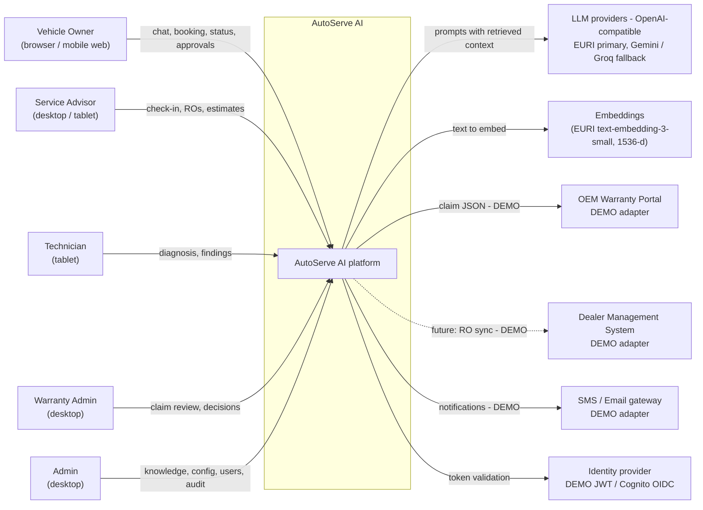
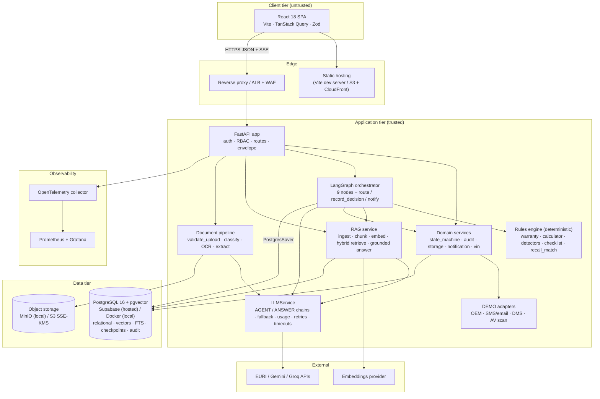
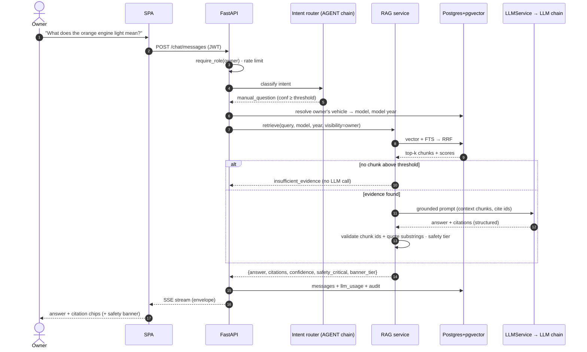
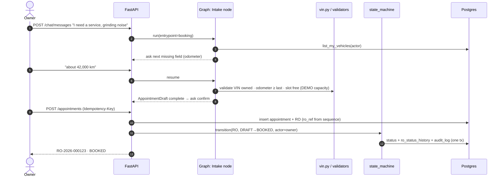
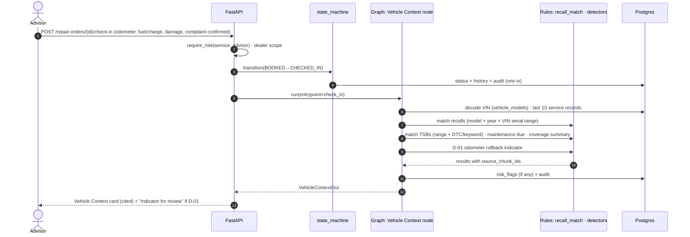
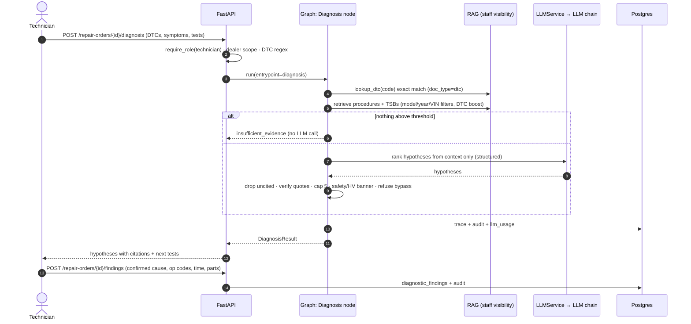
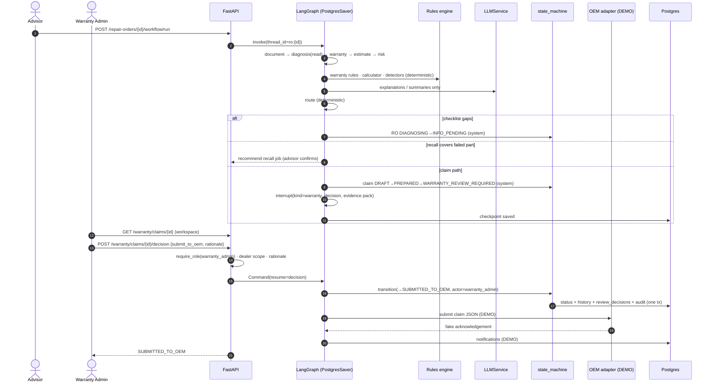
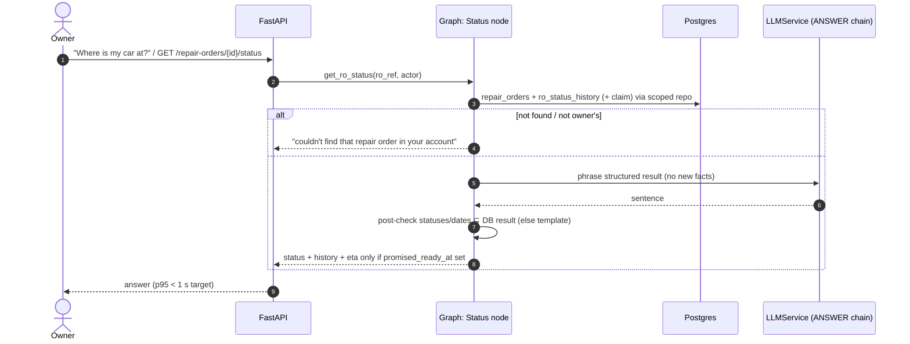
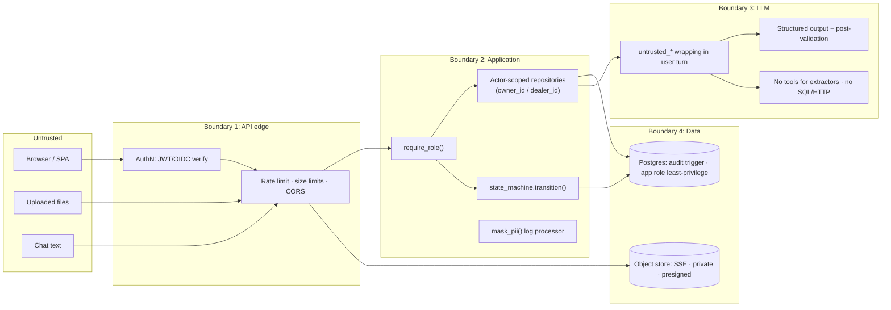

# AutoServe AI — High-Level Design

| | |
|---|---|
| **Version** | 1.0 · 2026-10-26 · task P0-3 |
| **Inputs** | `docs/PRD.md`, `.claude/CLAUDE.md`, `.claude/specs/*`, ADR-001…007 |
| **Companion docs** | `docs/LLD.md` (modules, state machines), `docs/API_SPEC.md`, `docs/DB_SCHEMA.md` |

---

## 1. System Context

**External systems.** Only the LLM providers and the embedding provider are real network dependencies. The OEM portal, DMS, SMS/email,
telematics, and AV scanning are **DEMO adapters** in this release (PRD NG2).

---

## 2. Containers

| Container | Responsibility | Tech |
|---|---|---|
| React SPA | Role workspaces: owner chat, my vehicles, RO detail, advisor board, tech copilot, warranty queue/workspace, admin | React 18, TS, Vite, Tailwind, TanStack Query, Zod, React Router |
| FastAPI app | AuthN/AuthZ, request validation, envelope, rate limiting, idempotency, SSE streaming | FastAPI, Pydantic v2 |
| Domain services | State transitions, audit chain, storage, notifications, VIN | SQLAlchemy 2 async |
| LangGraph orchestrator | Runs the service graph; interrupts for human decisions; resumable threads | LangGraph + PostgresSaver |
| RAG service | Synthetic corpus ingestion; hybrid retrieval with role/model filters; grounded cited answers | pgvector, Postgres FTS, LangChain |
| Document pipeline | Secure upload, classification, OCR, structured extraction, validation | pypdf, pdfplumber, pytesseract, Pillow |
| Rules engine | Warranty eligibility, estimate maths, anomaly detectors, checklist, recall match | Pure Python + `config/*.yaml` |
| LLMService | The only LLM client: AGENT/ANSWER chains with ordered fallback, structured output, retries, timeouts, `llm_usage` | langchain-openai (OpenAI-compatible) |
| Postgres + pgvector | System of record, vectors, FTS, LangGraph checkpoints, audit log | Supabase / Docker pg16 / RDS |
| Object storage | Uploaded documents + generated corpus PDFs | MinIO / S3 SSE-KMS |

---

## 3. Key Flows (sequence diagrams)

### 3.1 Owner manual Q&A

### 3.2 Booking → Repair Order

### 3.3 Check-in with VIN decode and recall match

### 3.4 Technician diagnosis

### 3.5 Warranty claim with human-review interrupt

### 3.6 Status lookup

---

## 4. Trust Boundaries and Enforcement Points

| Control | Where enforced | Notes |
|---|---|---|
| Authentication | FastAPI dependency (`core/security.py`) | DEMO JWT locally; OIDC JWKS in prod; alg pinned |
| Role-based access (RBAC) | `require_role()` on every route | Admin cannot reach decision endpoints |
| Owner isolation | Repositories (`vehicle.owner_id == actor.user_id`) | Out of scope → 404 |
| Dealer isolation | Repositories (`ro.dealer_id == actor.dealer_id`) | All staff queries; cross-dealer tests |
| State integrity | `state_machine.transition()` | Role + table check, history + audit in one tx |
| PII masking | structlog processor `mask_pii()`; eval report writer; OTel attribute filter | VIN → last 6 |
| Prompt-injection containment | Prompt builder in `LLMService`; extractor has no tools | D-09 flag on suspicious content |
| Upload safety | `documents/validate_upload.py` before storage | Magic bytes, size/pages, re-encode, AV hook (DEMO) |
| Audit immutability | DB trigger + hash chain + app-role grants | `verify_chain()` admin endpoint |
| File access | Presigned URL after authZ, short TTL | Bucket is private |

---

## 5. Deployment Views

| Environment | Frontend | Backend | Database | Storage | LLM |
|---|---|---|---|---|---|
| Local / CI | Vite dev server (compose) | uvicorn container | Docker `pgvector/pgvector:pg16` | MinIO | EURI → Gemini/Groq (FakeLLM in tests) |
| Hosted dev/demo | Static build | Container | **Supabase Postgres** (ADR-007) | MinIO / S3 | EURI → Gemini/Groq |
| AWS (design only, P5) | S3 + CloudFront | ECS Fargate behind ALB + WAF | RDS PostgreSQL 16 + pgvector | S3 SSE-KMS | EURI → Gemini/Groq via NAT egress |

---

## 6. Cross-Cutting Concerns

- **Observability:** OTel spans for HTTP → node → LLM → DB; Prometheus metrics (rules/85); `llm_usage` per call; Grafana dashboard + alerts.
- **Resilience:** LLM timeouts + `max_retries=2`; template fallbacks for explanation/phrasing; deterministic features unaffected by LLM outage.
- **Idempotency:** `Idempotency-Key` on state-creating POSTs; node-level `(ro_id, node, input_hash)`; duplicate resume is a no-op.
- **Configuration:** env (`pydantic-settings`) for infra; versioned YAML for business rules with `source_chunk_id` validated at startup.

---

## 7. ADR Review (P0-5)

| ADR | Review outcome |
|---|---|
| 001 Claude LLM | **Superseded by ADR-008** (OpenAI-compatible EURI/Gemini/Groq chains) on 2026-10-26 at the project owner's request. |
| 002 LangGraph | Agree. Checkpoint tables go in a dedicated `langgraph` schema via the connection `search_path` (implementation note, not a decision change). |
| 003 pgvector | Agree on the data design. Hosting already amended by ADR-007. |
| 004 React + Vite | Agree. No change. |
| 005 AWS ECS Fargate | Agree as the AWS production design. Hosted dev/demo uses Supabase (ADR-007); P5 docs must state both. |
| 006 Deterministic rules | Agree. No change. |
| 008 OpenAI-compatible LLM chains | Accepted 2026-10-26. Safety evals must pass for every AGENT-chain model. |
| 007 Supabase hosting | Accepted 2026-10-26. Pooler/prepared-statement behaviour to be verified in P1-2. |

ADR-001 is superseded by ADR-008; no other superseding ADR is needed.
