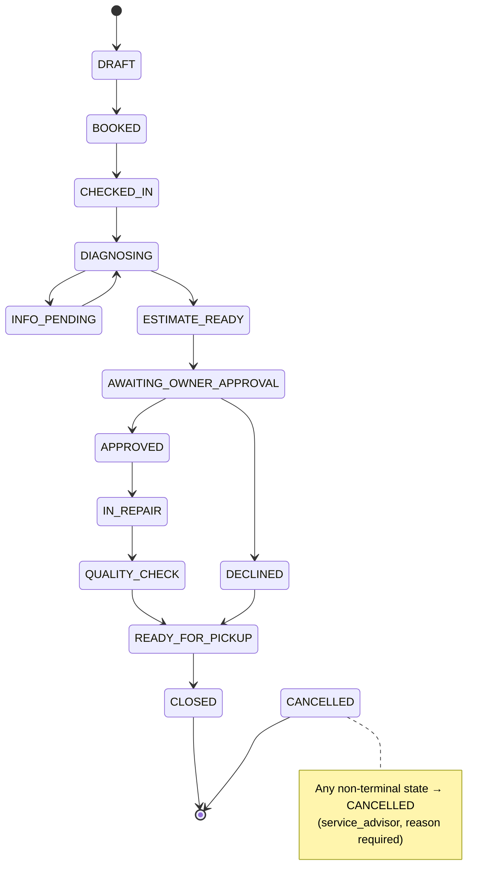
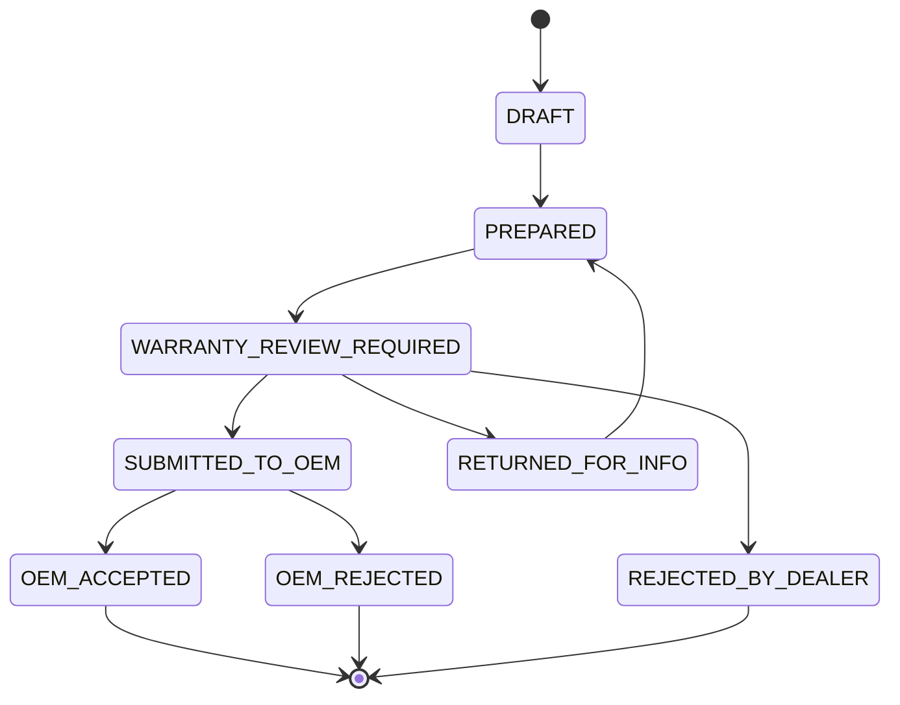

# AutoServe AI — Low-Level Design

| | |
|---|---|
| **Version** | 1.0 · 2026-10-26 · task P0-4 |
| **Inputs** | `docs/HLD.md`, `.claude/CLAUDE.md` §6–§10, `.claude/specs/graph-state.md`, `.claude/specs/agents/*` |

---

## 1. Module Design (matches CLAUDE.md §9)

### 1.1 Backend `autoserve-server/app/`

| Package / module | Responsibility | Key public API | Depends on |
|---|---|---|---|
| `main.py` | App factory, middleware (request_id, OTel, CORS, rate limit), exception handlers → envelope | `create_app()` | `core`, `api.v1` |
| `core/config.py` | `Settings` from env (pydantic-settings): DB URLs, LLM provider/models, timeouts, retries, thresholds file paths, retention | `get_settings()` | — |
| `core/security.py` | JWT encode/verify (DEMO HS256), OIDC JWKS verify (prod), `Actor` model, `require_role(*roles)` | `current_actor`, `require_role` | config |
| `core/logging.py` | structlog JSON config, `mask_pii()` processor | `configure_logging()` | — |
| `core/errors.py` | `DomainError` hierarchy → error codes (API_SPEC §2) | `NotFound`, `InvalidTransition`, … | — |
| `core/db.py` | Async engine/session (asyncpg), `statement_cache_size=0` when pooler mode | `get_session()` | config |
| `api/v1/*.py` | Thin routers: auth, chat, vehicles, repair_orders, documents, diagnosis, warranty, review, admin, health | FastAPI routers | services, schemas |
| `schemas/` | Pydantic v2 request/response + graph models (`schemas/graph.py`) | — | — |
| `models/` | SQLAlchemy 2 ORM (DB_SCHEMA.md) | — | — |
| `repositories/` | Actor-scoped data access. Every method takes `actor`; applies owner/dealer filter; returns `None` → 404 | `VehicleRepo`, `RORepo`, `ClaimRepo`, … | models |
| `services/state_machine.py` | Transition tables (data), `transition(entity, to, actor, reason)` → validate role + edge, write status + history + audit in one tx | `transition()` | repositories, audit |
| `services/audit.py` | Hash-chained append, `verify_chain()` | `AuditService.record()` | models |
| `services/storage.py` | MinIO/S3 put/get, SSE, presigned URLs | `StorageService` | config |
| `services/notification.py` | `DemoSmsEmailAdapter`, in-app notifications | `notify()` | repositories |
| `services/llm_service.py` | Only LLM client: AGENT chain `structured()`, ANSWER chain `text()`/`stream()`; ordered provider fallback, retries, timeouts, `llm_usage` (provider, model, fallback_index); `FakeLLM` for tests | `LLMService` | config |
| `services/vin.py` | VIN validate (ISO 3779 check digit) + decode via catalogue | `validate_vin()`, `decode_vin()` | repositories |
| `services/idempotency.py` | Store/replay responses keyed by `Idempotency-Key` | `idempotent()` decorator | models |
| `rag/ingest.py` · `chunker.py` · `embeddings.py` · `retriever.py` · `answer.py` | Corpus ingestion, structure-aware chunks, provider-switched embeddings, hybrid RRF retrieval with mandatory filters, grounded answering + validation + safety tier | `ingest_file()`, `retrieve()`, `answer()` | llm_service, models |
| `documents/validate_upload.py` · `classify.py` · `ocr.py` · `extract.py` · `schemas/` | Upload safety, classification, text extraction, structured extraction + validators, injection heuristics | `process_document()` | storage, llm_service, rules |
| `rules/warranty.py` · `calculator.py` · `detectors.py` · `checklist.py` · `recall_match.py` | **Deterministic** business logic; pure functions over typed inputs + config | `evaluate_warranty()`, `calculate_estimate()`, `run_detectors()`, `check_documents()`, `match_recalls()`, `match_tsbs()` | config only |
| `rules/config_loader.py` | Load + validate `config/*.yaml` (every number has `source_chunk_id` or `adr`) | `load_rules()` | — |
| `graph/state.py` | `ServiceGraphState` TypedDict + reducers | — | schemas |
| `graph/workflow.py` | `build_service_graph(checkpointer)`, `build_status_graph()` | — | nodes, routing |
| `graph/routing.py` | Deterministic edge functions | `after_intake()`, `route()` | — |
| `graph/nodes/*.py` | 9 nodes + `record_decision`, `notify` | `run(state, deps)` | services, rules, rag, tools |
| `graph/tools/*.py` | Allow-listed, actor-scoped tools for LLM nodes | `get_ro_status`, `check_open_recalls`, … | repositories |
| `prompts/` | Versioned templates `<node>_<purpose>_vN.md` | — | — |

### 1.2 Frontend `autoserve-client/src/`

| Path | Responsibility |
|---|---|
| `api/client.ts`, `api/schemas.ts` | fetch wrapper (JWT, Idempotency-Key, envelope unwrap), Zod schemas per response |
| `auth/` | Login, in-memory token, role guard `<RequireRole>` |
| `components/SafetyBanner.tsx`, `AIAssessmentBanner.tsx`, `CitationChip.tsx`, `StatusTimeline.tsx`, `DemoBadge.tsx` | Shared safety/trust UI |
| `pages/Login`, `OwnerChat`, `MyVehicles`, `RODetail`, `AdvisorBoard`, `TechCopilot`, `WarrantyQueue`, `WarrantyWorkspace`, `Admin` | Routes per CLAUDE.md |
| `i18n/en.json` | All fixed safety texts (`safety.*` keys) |

---

## 2. ServiceGraphState

Authoritative definition: `.claude/specs/graph-state.md`. Summary of ownership:

| Node | Writes | Reads |
|---|---|---|
| API layer | `thread_id, ro_id, claim_id, dealer_id, actor, request_id, entrypoint, diagnosis_input` | — |
| 1 Intake | `intake` | messages |
| 2 Vehicle Context | `vehicle_context` | intake |
| 3 Document | `documents` | vehicle_context |
| 4 Diagnosis | `diagnosis` | diagnosis_input, vehicle_context |
| 5 Warranty | `warranty` | vehicle_context, diagnosis, documents |
| 6 Estimate | `estimate` | diagnosis findings, warranty, vehicle_context |
| 7 Risk | `risk` | all of the above |
| route | `route` | documents, vehicle_context, warranty, estimate, risk, safety_critical |
| 9 Human Review | `review` | everything (evidence pack) |
| 8 Status | `status` | — (DB via tool) |
| any | `safety_critical` (OR), `execution_trace` (append), `errors` (append) | — |

Graph entrypoints (selected by the API through `entrypoint`):

| Entrypoint | Path |
|---|---|
| `booking` | intake → END (multi-turn, resumed per message) |
| `check_in` | vehicle_context → END |
| `diagnosis` | diagnosis → END |
| `warranty` | document → warranty → estimate → risk → route → (info_pending / recall_job / human_review → record_decision → notify) |
| `status` | status → END (separate compiled graph, no checkpointer) |
| `resume` | `Command(resume=decision)` on an interrupted thread |

Routing rules (`graph/routing.py::route`, evaluated in order):

1. `documents.checklist.missing` non-empty, or any field `needs_human_verification` unresolved → `info_pending`
2. an open recall covers the failed part (D-08 / W-RECALL-OVERLAP) → `recall_job`
3. otherwise → `human_review` with `reasons` = every true condition among: `risk.level == high`, any confidence < threshold,
   `estimate.totals.grand > review_amount_threshold`, `safety_critical`, unresolved inconsistency, `"binding decision required"` (always present)

---

## 3. State Machines

Implemented as data in `services/state_machine.py`:
`TRANSITIONS: dict[tuple[From, To], AllowedActors]` + per-edge requirements (`reason_required`, `note_required`, `precondition`).

### 3.1 Repair Order



| # | From → To | Allowed actor(s) | Requirements / side effects |
|---|---|---|---|
| RO-T01 | DRAFT → BOOKED | vehicle_owner (own vehicle), service_advisor (dealer) | Appointment exists; slot available (DEMO capacity); Idempotency-Key |
| RO-T02 | BOOKED → CHECKED_IN | service_advisor | Odometer, fuel/charge level, damage notes, complaint confirmed; triggers Vehicle Context + D-01 |
| RO-T03 | CHECKED_IN → DIAGNOSING | technician, service_advisor | — |
| RO-T04 | DIAGNOSING → INFO_PENDING | system, service_advisor | Checklist gaps / unverified fields listed; owner/advisor notified |
| RO-T05 | INFO_PENDING → DIAGNOSING | system (re-check passes), service_advisor | Re-check runs on every upload / field edit |
| RO-T06 | DIAGNOSING → ESTIMATE_READY | system | `estimate.estimable == true` |
| RO-T07 | ESTIMATE_READY → AWAITING_OWNER_APPROVAL | service_advisor ("send estimate") | Owner notified (DEMO); interrupt `estimate_approval` raised |
| RO-T08 | AWAITING_OWNER_APPROVAL → APPROVED | vehicle_owner; service_advisor with `consent_note` | ≥ 1 customer-pay line approved; line decisions stored |
| RO-T09 | AWAITING_OWNER_APPROVAL → DECLINED | vehicle_owner; service_advisor with `consent_note` | 0 lines approved |
| RO-T10 | APPROVED → IN_REPAIR | service_advisor, technician | — |
| RO-T11 | IN_REPAIR → QUALITY_CHECK | technician | Findings recorded (op codes, time, parts) |
| RO-T12 | QUALITY_CHECK → READY_FOR_PICKUP | service_advisor | — |
| RO-T13 | DECLINED → READY_FOR_PICKUP | service_advisor | — |
| RO-T14 | READY_FOR_PICKUP → CLOSED | service_advisor | — |
| RO-T15 | any non-terminal → CANCELLED | service_advisor | `reason` required; open claims for the RO move to REJECTED_BY_DEALER only by warranty_admin (not automatic) |

### 3.2 Warranty Claim



| # | From → To | Allowed actor(s) | Requirements / side effects |
|---|---|---|---|
| WC-T01 | DRAFT → PREPARED | system | Warranty + estimate + risk results present; checklist complete (else stays DRAFT, gaps listed) |
| WC-T02 | PREPARED → WARRANTY_REVIEW_REQUIRED | system (human_review node) | Evidence pack snapshot hash stored; interrupt `warranty_decision` |
| WC-T03 | WARRANTY_REVIEW_REQUIRED → SUBMITTED_TO_OEM | warranty_admin | `rationale`; DEMO OEM adapter writes claim JSON |
| WC-T04 | WARRANTY_REVIEW_REQUIRED → RETURNED_FOR_INFO | warranty_admin | `rationale`; AI-drafted message **approved by the admin** before sending |
| WC-T05 | WARRANTY_REVIEW_REQUIRED → REJECTED_BY_DEALER | warranty_admin | `rationale`; affected lines go back to the owner as customer-pay approval |
| WC-T06 | RETURNED_FOR_INFO → PREPARED | system (requested info added), service_advisor | Checklist re-run |
| WC-T07 | SUBMITTED_TO_OEM → OEM_ACCEPTED | system: DemoOemAdapter | DEMO acknowledgement |
| WC-T08 | SUBMITTED_TO_OEM → OEM_REJECTED | system: DemoOemAdapter | DEMO acknowledgement; lines go back to the owner as customer-pay approval |

### 3.3 `transition()` algorithm

```
transition(entity, to, actor, reason=None, note=None, idempotency_key=None):
  BEGIN
    row = SELECT ... FOR UPDATE (via actor-scoped repo; 404 if out of scope)
    edge = TRANSITIONS.get((row.status, to))           → else InvalidTransition (409)
    actor.role in edge.actors (or actor.is_system)     → else ForbiddenRole (403)
    edge.reason_required → reason; edge.note_required → note   → else RationaleRequired (422)
    edge.precondition(row)                              → else InvalidTransition (409, details)
    UPDATE status; INSERT *_status_history; AuditService.record(...)
  COMMIT
```

---

## 4. Per-Node Error, Retry, Timeout, Idempotency

Settings keys: `LLM_TIMEOUT_S` (default per purpose in config), `LLM_MAX_RETRIES=2`, `DB_STATEMENT_TIMEOUT_MS`, `NODE_TIMEOUT_S.<node>`.

| Node | Timeout (config key) | Retries | Idempotency key | On final failure |
|---|---|---|---|---|
| 1 Intake | `NODE_TIMEOUT_S.intake` | LLM ≤ 2 | `(conversation_id, turn_hash)` | Ask the owner to fill the field directly (form fallback) |
| 2 Vehicle Context | `NODE_TIMEOUT_S.vehicle_context` | DB ≤ 2 | `(ro_id, vin, history_hash)` | Node error → `errors[]`; route to human_review with reason |
| 3 Document | `NODE_TIMEOUT_S.document` (per page) | LLM ≤ 2 (schema retry with error) | `(document_id, sha256, prompt_version)` | Fields → `needs_human_verification`; RO → INFO_PENDING |
| 4 Diagnosis | `NODE_TIMEOUT_S.diagnosis` | LLM ≤ 2 | `(ro_id, diagnosis_input_hash, corpus_version)` | Return DTC meanings + matched TSBs only; `insufficient_evidence` |
| 5 Warranty | `NODE_TIMEOUT_S.warranty` | Explanation LLM ≤ 2 | `(ro_id, rules_version, inputs_hash)` | Template explanation (rules never fail open) |
| 6 Estimate | `NODE_TIMEOUT_S.estimate` | Summary LLM ≤ 2 | `(ro_id, lines_input_hash, price_list_version)` | Template summary; `not estimable` if inputs missing |
| 7 Risk | `NODE_TIMEOUT_S.risk` | Explanation LLM ≤ 2 | `(ro_id, detectors_version, inputs_hash)` | Template explanation from evidence |
| 8 Status | `NODE_TIMEOUT_S.status` (short, p95 < 1 s) | LLM ≤ 1 | none (read-only) | Template phrasing |
| 9 Human Review | none (waits on interrupt) | — | decision `idempotency_key` | Duplicate resume = no-op; wrong role keeps the interrupt |
| record_decision | `NODE_TIMEOUT_S.record_decision` | DB ≤ 2 | decision id | Transaction rollback; interrupt remains |
| notify | `NODE_TIMEOUT_S.notify` | Adapter ≤ 2 | `(entity_id, status, channel)` | Notification row `failed`; no state change |

Node idempotency store: `execution_trace` entries keyed by `input_hash` in the checkpoint, plus DB uniqueness on
`(ro_id, node, input_hash)` for side-effect rows (risk_flags, warranty_findings, estimate_lines are replaced per run in one tx).

Retries only cover **idempotent** operations (LLM calls, reads). Side-effecting writes run once inside a transaction.

---

## 5. Configuration Files (`autoserve-server/config/`)

| File | Contents | Validation |
|---|---|---|
| `rules.yaml` | Coverage periods, EV battery threshold, exclusions groups, maintenance tolerance, detector windows/tolerances, risk weights, review amount threshold, tax profiles | Every numeric value has `source_chunk_id` or `adr` |
| `document_checklists.yaml` | Required docs per (claim_type, component_group) | `source_chunk_id` per list |
| `intents.yaml` | Intent labels + examples + confidence threshold | — |
| `safety_keywords.yaml` | Safety systems → keywords/synonyms; `active_symptoms`; bypass patterns | Covers every system in rules/55 |

---

## 6. Prompt Templates

`autoserve-server/app/prompts/` and `autoserve-server/app/rag/prompts/`, named `<node>_<purpose>_v<N>.md`, with a front-matter header
`{id, version, model_tier: default|fast, output_schema}`. A new version is a new file. The active version is selected in config.
Each template change requires the safety-reviewer agent + a safety eval run.
