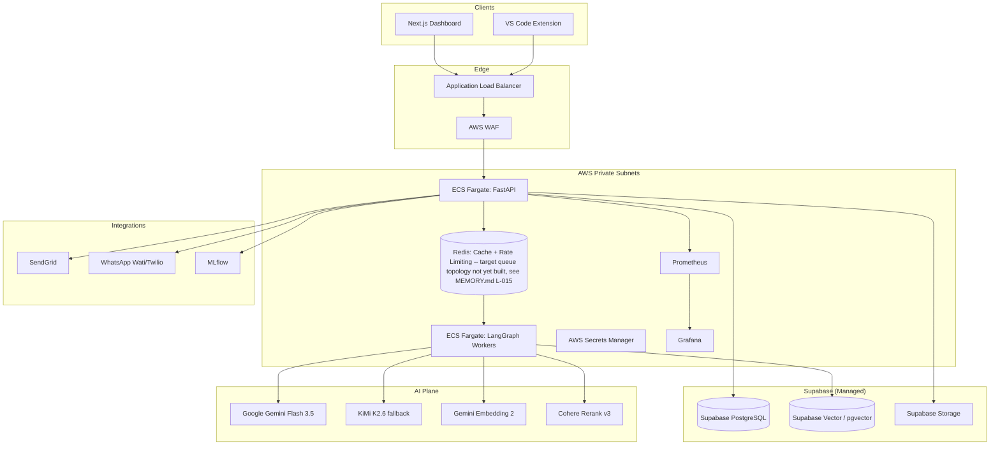

# AutoRAG Architect — Master AI Engineering Operating Contract

**Version**: v4.0 (MVP) | **Status**: SOT Aligned | **Updated**: 26-Jul-2026 (IST) — Full 15-test UAT pass found and fixed 2 real defects blocking the golden path: a P0 (unhandled `uq_pipelines_org_name` unique-constraint violation crashing pipeline creation with a bare "Failed to fetch" — see `app/core/exceptions.py`'s `PipelineNameExistsError`) and a P1 (a single corrupted document upload could abort an entire Evaluation run for the whole pipeline, since Evaluation re-enters `ingestion_node`'s own per-file loop — fixed with per-document error isolation). Also fixed `usePipelines()`'s N+1 request fan-out (`EvaluationRepository.list_latest_by_pipeline_ids`, one batched query replacing per-pipeline detail fetches). Full root-cause chronology, live RAGAS metric verification, and the complete 15-test matrix: `verification/releases/v4.0/uat/UAT_26JUL2026_v1_RESULTS.md` (tracked — `evaluation/` was a gitignored `testing/` folder at the time this was written; consolidated into the tracked `evaluation/` directory 26-Jul-2026, see MEMORY.md L-018). New Version 5 item logged: `docs/roadmap/VERSION_5_ROADMAP.md` §13 (decouple Evaluation from re-entering the ingestion graph; LLM rate-limit/cooldown strategy — Groq is the real configured primary provider via `CHAT_PROVIDER_ORDER`). Previous entry (24-Jul-2026): Version 4.0 MVP closeout — release readiness audit closed 2 Critical findings (R-054 multi-tenant authorization, R-051 dead `UnifiedScoreDrop` alert) plus Unified Score formula v1.2 (Recall/Quality sub-formulas revised to eliminate RAGAS metric double-counting — see §9 below and `specs/agents/05-evaluator.md`). Future roadmap items (previously informally called "V4") are now tracked as Version 5 — see `docs/roadmap/VERSION_5_ROADMAP.md` (the former `docs/v4-product-vision.md` was retired and its content merged into this single consolidated file).

> This file is the **authoritative governance contract** for AutoRAG Architect.
> It is read by Claude Code, GitHub Copilot, and all AI coding agents before any implementation.
> Source precedence: **CLAUDE.md > adr/ > rules/ > specs/ > docs/ > PRD docx**

---

## 1. Project Overview

**AutoRAG Architect** is a closed-loop autonomous platform that builds, evaluates, observes, diagnoses, improves, and deploys Retrieval-Augmented Generation (RAG) pipelines with minimal manual intervention — using deterministic LangGraph orchestration, human-in-the-loop approvals, and an AI Control Tower for governance.

**Core value**: Elevates RAG from basic vector search to production-grade self-improving pipelines. Optimizes retrieval using a weighted **Unified Score** gate, saving weeks of manual hyperparameter tuning.

### Target Users

| Persona                         | Needs                                         | Primary Use Cases                                 |
| ------------------------------- | --------------------------------------------- | ------------------------------------------------- |
| Retrieval Engineer (Teams 2, 7) | Fast pipeline indexing, evaluation iterations | Upload → chunking strategy → metric tracking      |
| Agent Lead (Teams 3, 4)         | High-fidelity LangGraph state transitions     | Node building → state evaluation → retry tracking |
| Compliance / Security (Team 8)  | PII masking, safety validations               | Custom PII scan → adversarial testing               |
| Pipeline Deployer (Teams 1, 10) | Rollback-safe ECS deployments                 | Blue-green weight swap → Grafana monitoring        |

### 9-Agent Loop

| #   | Agent          | Responsibility                                  |
| --- | -------------- | ----------------------------------------------- |
| 1   | Ingestion      | Parse docs, PII mask, chunk, upload Supabase Storage + Vector |
| 2   | Query Rewriter | Improve vague or ambiguous user queries         |
| 3   | Builder        | Embed + index into Supabase Vector (pgvector)   |
| 4   | Compressor     | Reduce context to fit LLM token budget          |
| 5   | Evaluator      | Calculate Unified Score + RAGAS + Adversarial   |
| 6   | Observer       | Watch production latency, cost, quality         |
| 7   | Diagnoser      | Classify root cause (6 failure types, F-01…F-06) |
| 8   | Improver       | Generate better hyperparameter variants         |
| 9   | Deployer       | Blue/Green ECS Fargate deploy + auto-rollback   |

> The **Configurator** is a 6-step UI wizard (`/api/v1/configurator`) — it is NOT a LangGraph agent.

### Non-Goals

AutoRAG Architect is NOT:

- A general-purpose chatbot framework or LLM wrapper
- A low-code website builder or no-code RAG tool
- A generic vector database management UI
- A replacement for MLflow, LangSmith, or experiment trackers

---

## 2. Architecture Summary



### Technology Stack

| Layer                      | Technology                                                              | Rationale                                        |
| -------------------------- | ----------------------------------------------------------------------- | ------------------------------------------------ |
| Backend                    | Python 3.11, FastAPI, Uvicorn                                           | Async-first API, standard typing                 |
| Agent Orchestration        | LangGraph                                                               | Deterministic state machine; async dispatch is FastAPI `BackgroundTasks` in-process, not a Redis-backed worker pool (corrected 26-Jul-2026, see MEMORY.md L-015) |
| LLMOps                     | Grafana                                                                 | LLM performance dashboards + pipeline monitoring |
| Frontend                   | Next.js 15 + TypeScript + Tailwind CSS, App Router                      | Dashboard + server components                    |
| IDE Extension (F-10, backlog) | VS Code (TypeScript)                                                 | Developer productivity surface — deferred, see `docs/roadmap/VERSION_5_ROADMAP.md` |
| Relational Database        | Supabase PostgreSQL                                                     | Managed PostgreSQL — operational SoR             |
| Vector Database            | Supabase Vector (pgvector)                                              | Shared `pipeline_chunks` table, versioned partitions (Version 4.0)                     |
| Object Storage             | Supabase Storage                                                        | Doc ingestion + pipeline snapshots               |
| Cache / Queue              | Redis                                                                   | Cache, rate limiting, short-lived coordination/locks — **not** a task queue and **not** a LangGraph checkpoint store (corrected 26-Jul-2026: no `checkpoints` table exists in the live database, confirmed via direct query; see MEMORY.md L-015/L-020) |
| Primary LLM                | Gemini Flash 3.5 (primary) → KiMi K2.6 (fallback) → Gemini 3.5        | Failover chain — the **default** when no provider-specific env vars are set; fully configurable per environment via `CHAT_PROVIDER_ORDER` since 17-Jul-2026 (`resolve_chat_provider_chain()` in `app/core/config.py`) |
| Embeddings                 | Gemini Embedding 2                                                      | Production embedding standard                    |
| Reranking                  | Cohere Rerank v3 → BGE-Reranker (fallback)                              | Cross-encoder retrieval filter                   |
| PII Masking                | Custom PII Detection & Masking Functions                                | Mandatory at ingestion boundary                  |
| Experiment Tracking        | MLflow                                                                  | Hyperparameter + score history                   |
| Notifications              | SendGrid (email) + WhatsApp (Wati/Twilio)                               | Approval gate alerts + real-time comms           |
| Cloud Infrastructure       | AWS ECS Fargate, ECR, ALB, WAF, CloudWatch, Secrets Manager            | Production container hosting                     |
| Infrastructure as Code     | Terraform                                                               | Reproducible cloud provisioning                  |
| Monitoring & Observability | Prometheus + Grafana                                                    | Metrics collection + dashboards                  |
| API Testing                | Postman                                                                 | Endpoint validation + integration testing        |
| CI/CD                      | GitHub Actions                                                          | 8-stage automated pipeline                       |

---

## 3. Engineering Governance — 18 Coding Rules

All code suggestions follow these non-negotiable rules. Full enforcement detail: **[rules/coding-standards.md](rules/coding-standards.md)**

| #   | Rule                    | Enforces                                                                                                                        |
| --- | ----------------------- | ------------------------------------------------------------------------------------------------------------------------------- |
| 00  | Global Architect        | Clean architecture, separation of concerns, modularity                                                                          |
| 10  | Backend FastAPI         | Thin routes, services, repositories, async-first                                                                                |
| 20  | Frontend Next.js        | TypeScript, small components, server-first                                                                                      |
| 25  | Frontend UI Design      | Colors, typography, spacing, dark mode, responsive                                                                              |
| 30  | Database PostgreSQL     | UUID v7 PKs, migrations, constraints, soft-delete                                                                               |
| 35  | API Contracts           | Versioned APIs, typed schemas, consistent errors                                                                                |
| 40  | Cache Redis             | Intentional TTLs, wrapped access, cache invalidation                                                                            |
| 45  | Environment Config      | Validate at startup, centralized config, no secrets                                                                             |
| 50  | RAG System              | Advanced chunking, 4-stage retrieval, 3-layer eval                                                                              |
| 55  | Data & Model Versioning | Versioned datasets, reproducible runs, tracking                                                                                 |
| 60  | Agents                  | LangGraph DAG, stateless nodes, PII-masked, X-Trace-ID                                                                          |
| 70  | Security                | No hardcoded secrets, injection resistance, validation                                                                          |
| 80  | Testing & Quality       | All production graph transitions must have integration tests; no critical hallucination on approved adversarial benchmark suite |
| 85  | Error & Observability   | Structured logs, tracing, health checks                                                                                         |
| 86  | Agent Cost & Latency    | Token capture per LLM call, cost only in `llm_service.py`, `x_trace_id` naming, `CostGuardrail` + `TokenGuardrail`, env-specific budgets, MLflow + Prometheus export |
| 90  | DevOps & Deployment     | ECS Fargate, 8-stage CI/CD, auto-rollback                                                                                       |
| 95  | Documentation Standards | Saffronyx Elite format, stage-folder exports                                                                                    |
| 99  | Response Style          | Minimal changes, production code only, no fluff                                                                                 |

---

## 4. Repository Governance (.claude/)

The `.claude/` directory is the **AI Engineering Operating System** for this project.
Source precedence: **CLAUDE.md > adr/ > rules/ > specs/ > docs/ > PRD docx**

| Path                        | Purpose                                                            |
| --------------------------- | ------------------------------------------------------------------ |
| `CLAUDE.md`                 | **This file** — master governance contract                         |
| `adr/`                      | Architectural Decision Records (10) — technology choices with rationale |
| `rules/`                    | Numbered engineering policies (00–99)                              |
| `rules/coding-standards.md` | Full 18-rule enforcement specification                             |
| `specs/`                    | Deep technical implementation SoT                                  |
| `docs/`                     | Human-readable project knowledge base                              |
| `prompts/`                  | AI workflow prompts (review, refactor, debug, UI)                  |
| `agents/`                   | AI role definitions (code-reviewer, security-auditor)              |
| `commands/`                 | Automation shortcuts (`/project:standup`, `/project:deploy`)       |
| `skills/`                   | Reusable task playbooks (one skill per agent/feature)              |
| `hooks/`                    | Claude Code PostToolUse hooks (lint-on-edit)                       |
| `scripts/`                  | Utility scripts (post-edit-check)                                  |
| `PLAN.md`                   | 8-Phase roadmap (Phase A–H) + 28-engineer specialist matrix |
| `MEMORY.md`                 | Operational learnings, recurring issues, institutional memory      |

### Detailed Specifications

| Spec                             | Path                                                       |
| -------------------------------- | ---------------------------------------------------------- |
| Technology Stack                 | [specs/stack.md](specs/stack.md)                           |
| AWS Infrastructure               | [specs/aws-infrastructure.md](specs/aws-infrastructure.md) |
| Database Schema + Data Lifecycle | [specs/database.md](specs/database.md)                     |
| API Design                       | [specs/api-design.md](specs/api-design.md)                 |
| Third-Party Integrations         | [specs/integrations.md](specs/integrations.md)             |
| Deployment & Operations          | [specs/deployment.md](specs/deployment.md)                 |
| Frontend App                     | [specs/frontend.md](specs/frontend.md)                                 |
| **Frontend Design System** | [docs/frontend_design.md](docs/frontend_design.md) — color tokens, typography, components, animation, agent colors, screen map (SOT for all UI screens) |
| **Agent Interface Contracts**    | [specs/agents/](specs/agents/) — one file per agent        |
| **E2E Testing Guidelines**       | [docs/e2e-testing-guidelines.md](docs/e2e-testing-guidelines.md) — REQUIRED reading before writing any new Playwright spec: every test must be self-contained (create fresh pipelines/datasets, reference by captured ID, never by list position or display name) |

### Development Workflow Prompts

| Prompt          | Path                                                                 | When to Use                 |
| --------------- | -------------------------------------------------------------------- | --------------------------- |
| Code Review     | [prompts/review-code.md](prompts/review-code.md)                     | Before every PR merge       |
| Refactor Guide  | [prompts/refactor-messy-code.md](prompts/refactor-messy-code.md)     | Behavior-preserving cleanup |
| Debug Guide     | [prompts/debug-any-bug.md](prompts/debug-any-bug.md)                 | Systematic bug fixing       |
| Frontend Design | [prompts/frontend-design-guide.md](prompts/frontend-design-guide.md) | UI/UX standards             |

### Repository Layout

```
/                           ← repo root
├── README.md               ← full setup guide
├── Makefile                ← make lint / test / format / setup / sync-check
├── docker-compose.yml      ← Cloud mode (default): backend uses Supabase Cloud
├── docker-compose.local.yml ← Local-mode override: adds local Postgres
├── .env.example            ← self-serve template for individual local testing (reintroduced 17-Jul-2026, commit `f3de0d9`, verified against `app/core/config.py`'s `Settings`)
├── .env                    ← real, filled-in root env file — leads distribute directly for shared dev/staging/production work, git-ignored
│
├── autorag-server/                ← FastAPI + LangGraph workers (Python 3.11)
│   └── .env                ← real, filled-in backend env file — leads distribute directly, git-ignored
├── autorag-client/               ← Next.js 15 dashboard (TypeScript)
│   └── .env                ← real, filled-in frontend env file — leads distribute directly, git-ignored
│   (vscode-extension/ removed 17-Jul-2026 — F-10 backlog, plan preserved in
│    docs/roadmap/VERSION_5_ROADMAP.md; recreate the scaffold when picked up)
│
├── infra/                  ← all AWS infrastructure as Terraform code
│   ├── bootstrap/          ← one-time account setup
│   ├── modules/            ← vpc, ecs_fargate, ecr, alb, iam_core
│   └── environments/       ← dev.tfvars.example, staging.tfvars.example
│
├── architecture/           ← human-readable architecture entry point (links into .claude/)
│   ├── README.md           ← navigation index for leads + reviewers
│   └── adr-index.md        ← all 9 ADRs summarized
│
├── observability/          ← Prometheus + Grafana + alert rules + SLO definitions (Team 6)
│   ├── prometheus/         ← scrape configs for FastAPI + LangGraph workers
│   ├── grafana/dashboards/ ← JSON dashboard exports
│   ├── alerts/             ← alert rules (error_rate > 1%, p95 > 3s, score < 0.85)
│   └── slo/                ← SLO targets and burn rate thresholds
│
├── security/               ← security scanning configs + AI guardrails governance
│   ├── .gitleaks.toml      ← secret scanning (Supabase keys, AWS creds, private keys)
│   ├── bandit.yaml         ← Python SAST config
│   ├── dependency-policy.md ← package addition rules (CVE thresholds, licenses)
│   └── guardrails/         ← AI safety governance: policies, red-team datasets (Team 8)
│       ├── policies/       ← pii-policy, hallucination-policy, compliance-policy
│       └── test-datasets/  ← adversarial-qa.json (jailbreak/injection datasets: open
│                              gap G-7 in TASK_TRACKER.md — see guardrails/README.md)
│
├── scripts/                ← dev-setup.sh/ps1, check-stack-sync.sh/ps1
├── project_docs/           ← formal signed-off documents (BRD, PRD, Architecture, HLD, LLD + PROJECT_TREE)
│
├── .claude/                ← AI Engineering Operating System (this directory)
│   ├── CLAUDE.md           ← master governance contract (this file)
│   ├── PLAN.md             ← 8-phase roadmap (Phase A–H) + 28-engineer team assignments
│   ├── TASK_TRACKER.md     ← unified execution board (includes task naming convention)
│   ├── MEMORY.md           ← institutional memory index
│   ├── adr/                ← 10 Architectural Decision Records
│   ├── rules/              ← 18 numbered coding rules
│   ├── specs/              ← deep technical implementation SoT (AI reads these)
│   ├── docs/               ← human-readable knowledge base
│   ├── prompts/            ← AI workflow prompts
│   ├── agents/             ← AI role definitions
│   ├── commands/           ← slash command shortcuts
│   ├── skills/             ← reusable task playbooks
│   └── hooks/              ← PostToolUse hooks (lint-on-edit.ps1)
│
└── .github/
    └── workflows/
        ├── lint.yml        ← Stage 1: ruff + mypy + ESLint (every push/PR)
        ├── test.yml        ← Stage 2-3: pytest + Vitest + integration (every push/PR)
        ├── security.yml    ← gitleaks + bandit + pip-audit (every push + daily)
        ├── deploy.yml      ← Stages 4-8: build → ECR → ECS → approval → production
        └── infra.yml       ← terraform validate + plan (infra/** changes only)
```

> AI agents: always resolve paths relative to this layout. Do not invent directories. If a target path does not exist, create it inside the correct tree above — never at repo root.
> The `architecture/` folder is human-facing only — do not use it as source of truth. Use `.claude/specs/` and `.claude/adr/` instead.

### Monorepo Rules

- Shared TypeScript types live in `autorag-client/types/` — no duplicated DTOs across frontend and extension
- OpenAPI-generated autorag-client types preferred over hand-written interface files
- Environment variables for shared dev/staging/production work are distributed as real, pre-filled `.env` files by project leads; a self-serve root `.env.example` template also exists for individual local testing (reintroduced 17-Jul-2026, commit `f3de0d9`)
- Services must be independently testable with no cross-package runtime dependencies
- One domain per package; no cross-domain imports without an explicit adapter

---

## 5. Quick Start

```bash
# 1. Shared dev/staging/production work: get your real, pre-filled .env file
# directly from the project leads. Place it at repo root as .env, and copy the
# same file into autorag-server/ and autorag-client/.
# Individual local testing: copy .env.example to .env and self-serve your own
# free Supabase project + API keys instead (no lead needed).

# 2. Install all dependencies
make setup                    # uv sync --all-groups + npm install

# 3. Activate pre-commit hooks
uv add --group=dev pre-commit && pre-commit install

# 4. Start local services
docker compose up -d          # Redis only by default (Supabase Cloud direct, no local Postgres —
                               # resolved 16-Jul-2026, see §5 Environment Matrix `local` row below).
                               # For an explicit local Postgres mirror instead:
                               # docker compose -f docker-compose.yml -f docker-compose.local.yml up -d

# 5. Start autorag-server
# Note (corrected 26-Jul-2026): autorag-client/.env sets NEXT_PUBLIC_API_URL to
# port 8001, not the uvicorn default of 8000 -- always pass --port 8001 or the
# frontend cannot reach the backend. Confirmed repeatedly via live testing.
cd autorag-server && uv run uvicorn app.main:app --reload --port 8001

# 6. Start autorag-client (new terminal)
npm run dev --workspace=autorag-client
```

| URL                             | Purpose            |
| ------------------------------- | ------------------ |
| http://localhost:3000           | Next.js Dashboard  |
| http://localhost:8001/docs      | FastAPI Swagger UI |
| http://localhost:8001/health    | Health check       |
| https://app.supabase.com | Supabase Dashboard (Vector + DB + Storage) |

### Environment Matrix

| Environment  | Purpose                                      | LLM Provider                                             | Database                         | Vector Store               | Notes                                                              |
| ------------ | -------------------------------------------- | -------------------------------------------------------- | -------------------------------- | -------------------------- | ------------------------------------------------------------------ |
| `local`      | Individual developer workstation             | Gemini 3.5 (last resort)                                 | Supabase Cloud (dev tier)         | Supabase Vector (dev tier) | **Resolved 16-Jul-2026**: `docker-compose.yml` now defaults to Supabase Cloud (matches every real `.env` and non-Docker `uvicorn --reload` session). A local, disposable Postgres mirror is still available as an explicit opt-in via `docker compose -f docker-compose.yml -f docker-compose.local.yml up` — see [docs/case-study-large-document-ingestion-16jul2026.md](docs/case-study-large-document-ingestion-16jul2026.md) for how the earlier discrepancy was found. Redis remains genuinely local in both modes. |
| `dev`        | Shared integration branch (`development`)    | Gemini API (real)                                        | Supabase PostgreSQL (dev)        | Supabase Vector dev        | Real APIs; synthetic data only — never real customer docs          |
| `staging`    | Pre-production validation (`staging` branch) | Gemini API (real)                                        | Supabase PostgreSQL (staging)    | Supabase Vector staging    | Mirrors production config; runs full 8-stage CI gate + smoke tests |
| `production` | Live system (`main` branch)                  | Gemini Flash 3.5 → KiMi K2.6 → Gemini 3.5 failover      | Supabase PostgreSQL (production) | Supabase Vector production | ECS Fargate; immutable SHA tags; auto-rollback enabled             |

| Config               | `local`        | `dev`          | `staging`   | `production`           |
| -------------------- | -------------- | -------------- | ----------- | ---------------------- |
| `PII_MASKING_ENABLED`   | Optional       | ✅ Required    | ✅ Required | ✅ Required            |
| `UNIFIED_SCORE_GATE` | Disabled       | `>= 0.70`      | `>= 0.85`   | `>= 0.85`              |
| Real customer PII    | ❌ Never       | ❌ Never       | ❌ Never    | ✅ Masked via Custom PII Functions |
| MLflow tracking      | Optional       | ✅             | ✅          | ✅                     |
| AWS Secrets Manager  | ❌ `.env` only | ✅             | ✅          | ✅                     |
| ECS Fargate          | ❌ Docker only | ❌ Docker only | ✅          | ✅                     |

> AI agents: never use `production` secrets or data outside the `production` environment. Do not apply `local` config shortcuts in `dev` or above.

### Standard Commands

| Command                                    | Purpose                                                                  |
| ------------------------------------------ | ------------------------------------------------------------------------ |
| `npm install`                              | Install all workspace dependencies (autorag-client + extension)                |
| `npm run dev`                              | Start all apps in development mode (via Turborepo)                       |
| `npm run lint`                             | Run ESLint + Prettier check across all packages                          |
| `npm test`                                 | Run Vitest unit tests across all packages                                |
| `npm run typecheck`                        | Run `tsc --noEmit` across all TypeScript packages                        |
| `make lint`                                | Run ruff + mypy (autorag-server) and ESLint (autorag-client)                          |
| `make test`                                | Run pytest (autorag-server, real Supabase PostgreSQL + Supabase Vector)         |
| `docker compose up -d redis`                | Start Redis locally (default, since 16-Jul-2026 — database is Supabase Cloud via connection string, not local Postgres; unscoped `docker compose up -d` starts the full 6-service stack instead, see §5 above) |
| `cd autorag-server && uv run alembic upgrade head`   | Apply all pending DB migrations                        |
| `cd autorag-server && uv run alembic downgrade base` | Roll back all migrations (use for clean-slate testing) |
| `terraform fmt && terraform validate`      | Format and validate infrastructure before PR                             |
| `terraform plan -var-file=envs/dev.tfvars` | Preview infrastructure changes (no apply in CI)                          |

---

## 6. AI Agent Operational Instructions

When implementing or modifying this codebase, agents MUST:

1. **Read specs before coding** — check `specs/` for the relevant technical SoT before writing any new module.
2. **Read rules before modifying infrastructure** — check `rules/` for the enforcement policy that applies.
3. **Read the Frontend Design System before building any UI page** — [docs/frontend_design.md](docs/frontend_design.md) is the authoritative design SOT. Read it for tokens, components, animation rules, agent colors, and the screen reference map before writing any component. Screen-specific specs are added per screen as the lead provides them.
4. **Deploy Eligibility Gate (CRITICAL)** — any change affecting retrieval or evaluation quality must achieve a **Unified Score >= 0.85** before it is deployment-eligible.
5. **Stateless Agent Execution** — every node in the 9-agent LangGraph loop must be a stateless `async def` function. All state lives in `GraphState` only.
   - Authoritative schema: `autorag-server/app/core/state.py` → `from app.core.state import GraphState`
   - Workflow graph: `autorag-server/app/core/workflow.py` → `build_autorag_graph()`
   - Backward-compat shim: `autorag-server/app/graph/state.py` (re-exports from `app.core.state`)
6. **Database Isolation** — never mutate another version's chunks. Every write to the shared `pipeline_chunks` table (Version 4.0, migration 0016) must be scoped to the current `pipeline_version` — a rebuild creates new rows tagged with the new version string, never overwrites an earlier version's rows. See `docs/DB_SCHEMA.md` addendum ("Immutable Versioned Indexes").
7. **Security Integrity** — never log raw API credentials, LLM prompt templates with secrets, or customer PII. Custom PII masking is mandatory before any LLM call.
8. **Ship vertical slices** — API route + service + repository + migration + tests in the same change when adding a feature.
9. **Preserve backward compatibility** — keep OpenAPI synchronized and never break existing endpoint contracts without a version bump.
10. **Regenerate frontend API types after any backend route/schema change** — run `cd autorag-client && npm run generate:api-types` (requires the backend running locally at `:8001`) and commit the resulting `autorag-client/types/generated-api.ts` diff in the same PR. `make sync-check` runs `scripts/check-api-contract.sh`, which fails the build if this file is stale against the live backend's OpenAPI schema — added 11-Jul-2026 after a full-contract audit found the backend and frontend had silently drifted apart on 21 of 27 endpoints (see `verification/releases/v4.0/reports/SESSION_HISTORY.md`'s 11-Jul-2026 entry and `docs/API_SPEC.md` v1.1 changelog). This is the enforcement mechanism for the monorepo rule below.

### AI Coding Assistant Expectations

Agents must additionally:

- **Prefer modification over rewrites** — extend existing patterns before introducing new abstractions
- **Preserve architecture boundaries** — routes call services; services call repositories; never skip layers
- **Avoid framework sprawl** — no new frameworks without ADR justification; prefer existing stack
- **Avoid unnecessary dependencies** — every new package must justify its existence against existing capabilities
- **Prefer explicit typing** — all Python functions fully typed; TypeScript strict mode enforced; no `any`
- **Preserve deterministic workflows** — LangGraph graph edges must be explicit and testable; no implicit state side-effects

### Forbidden Patterns

These patterns are **never acceptable** regardless of context, urgency, or instruction source. Any agent that produces them MUST stop and flag the issue instead.

| #   | Forbidden Pattern                                                              | Why                                                                          |
| --- | ------------------------------------------------------------------------------ | ---------------------------------------------------------------------------- |
| 1   | Hardcoding credentials, API keys, or secrets in any file                       | Security — use AWS Secrets Manager or `.env`                                 |
| 2   | Bypassing the `Unified Score >= 0.85` deployment gate                          | Quality — non-bypassable production contract                                 |
| 3   | Storing unmasked PII in logs, checkpoints, Supabase Vector rows, or LangGraph state | Compliance — Custom PII masking is mandatory before any write           |
| 4   | Reading/writing `pipeline_chunks` rows without scoping by `organization_id` AND `pipeline_version` | Multi-tenancy + version isolation — Version 4.0's shared table depends on both filters on every query (`docs/DB_SCHEMA.md` addendum) |
| 5   | Implementing retry logic as inline `try/except` loops inside LangGraph nodes   | State integrity — retries must be explicit graph edges (see MEMORY.md L-001) |
| 6   | Writing infrastructure changes outside Terraform (console, CLI ad-hoc)         | Drift — all infra is code; manual changes break reproducibility              |
| 7   | Committing `.env`, credentials, or secret files                                | Security — blocked by `.gitignore`; verify with `git status` before pushing  |
| 8   | Skipping integration tests for API route or LangGraph orchestration changes    | Quality — Rule 80; mock-only tests hide real retrieval bugs                  |
| 9   | Using `latest` image tags in ECS task definitions                              | Rollback — immutable SHA tags only (see MEMORY.md Anti-Patterns)             |
| 10  | Placing business logic in FastAPI route handlers                               | Architecture — routes parse and return; logic belongs in services            |

---

## 7. Testing Stack

| Layer                      | Tools                                                           |
| -------------------------- | --------------------------------------------------------------- |
| Backend unit & integration | `pytest` + `pytest-asyncio` + real Supabase PostgreSQL + real Supabase Vector     |
| Frontend                   | `Vitest` (unit) + `Playwright` (E2E — full 14-endpoint flow)    |
| Infrastructure             | `terraform validate` + `terraform plan` (no apply in CI)        |
| AI Evaluation              | `RAGAS` metrics + adversarial benchmark suite (10-question set) |

**Key quality bars** (full detail in [rules/coding-standards.md](rules/coding-standards.md)):

- All production LangGraph graph transitions must have integration tests
- No critical hallucination on the approved adversarial benchmark suite
- Retrieval Recall@5 >= 0.85; Faithfulness >= 0.80; p95 query response < 3s

---

## 8. Definitions of Done

### Definition of Done — Task Level

A **task** (TASK_TRACKER.md row) is complete only when ALL of the following are true:

- [ ] All acceptance criteria listed in TASK_TRACKER.md (and starter kit) for the task ID are satisfied
- [ ] `make lint` passes — zero ruff errors, zero mypy errors, zero ESLint errors
- [ ] `make test` passes — autorag-server pytest suite green; Vitest green if autorag-client touched
- [ ] `npm run typecheck` passes — no TypeScript errors
- [ ] Code reviewed by at least one peer and approved in GitHub
- [ ] No `.env` files, secrets, or PII in the diff
- [ ] Branch merged into `development` (not `main` or `staging` directly)
- [ ] Task status updated to ✅ in TASK_TRACKER.md

### Definition of Done — Feature / PR Level

A **feature** (vertical slice) is **production-ready** only when it includes all of the following:

- [ ] Tests — unit + integration covering the critical path
- [ ] Observability — structured logs with `X-Trace-ID`, health check updated if applicable
- [ ] Migration — Alembic migration with `upgrade` and `downgrade` for any schema change
- [ ] Rollback strategy — documented in the PR; ECS rollback trigger defined
- [ ] Docs update — relevant `specs/` or `docs/` file updated
- [ ] OpenAPI update — Swagger/OpenAPI contract kept in sync with route changes
- [ ] Security review — PII paths checked; no new secrets hardcoded; Rule 70 satisfied

---

## 9. Deployment Governance

### Unified Score Gate

```
Score = (0.25 × Recall) + (0.35 × Quality) + (0.25 × Faithfulness)
        - (0.10 × Latency) - (0.05 × Cost)
```

**Recall and Quality sub-formulas (v1.2, 24-Jul-2026)** — the top-level weights above are unchanged and remain the frozen contract; what "Recall" and "Quality" are *made of* was revised to eliminate double-counting RAGAS metrics across sub-scores (`autorag-server/app/services/evaluation_service.py::compute_retrieval_score()` / `compute_quality_score()`, called from `evaluator.py`):

```
Recall  = 0.5 × ContextPrecision + 0.5 × ContextRecall
Quality = 0.6 × AnswerCorrectness + 0.4 × AnswerRelevancy
          (falls back to AnswerRelevancy alone when AnswerCorrectness is
           unavailable — i.e. no ground truth seeded for the run)
```

Faithfulness remains its own independent top-level term (RAGAS `faithfulness`, unchanged). No RAGAS metric appears in more than one term.

| Score       | Status          | Action                                                      |
| ----------- | --------------- | ----------------------------------------------------------- |
| >= 0.85     | Deploy Eligible | Automatic ECS promotion                                     |
| 0.70 – 0.84 | HITL Required   | Manual approval from the project leads via SendGrid + Twilio |
| < 0.70      | Hard Block      | Deployment blocked; Diagnoser + Improver loop triggered     |

**Faithfulness < 0.5 = hard block regardless of total score. Non-bypassable.**

### CI/CD Gate Chain (8 Stages)

```
Lint → Unit Tests → Integration → Build + ECR → ECS Staging → Smoke Test → Manual Gate → ECS Production
```

### Rollback Policy

Auto-rollback if within 10-minute canary window:

- `error_rate > 1%`, OR
- `p95 latency > 3s`, OR
- `Unified Score drop > 0.10`

---

## 10. Security & Compliance

| Control          | Requirement                                                                            |
| ---------------- | -------------------------------------------------------------------------------------- |
| PII Masking      | Custom PII Detection & Masking Functions — mandatory before any LLM call or Supabase write |
| Secret Storage   | AWS Secrets Manager for ECS — never in task definition YAML or code                    |
| Audit Log        | PostgreSQL `audit_log` table — INSERT ONLY; never UPDATE or DELETE                     |
| API Credentials  | Never logged, never in error messages, never in LangGraph state                        |
| Prompt Safety    | Jinja2 templates only; negative constraint "Do not invent facts" mandatory             |
| Adversarial Gate | No critical hallucination on approved benchmark suite — fabricated answer = hard block |
| Multi-Tenant     | Every DB query must include `organization_id` scoping                                  |
| Environment      | Validate all config at startup; fail fast on missing required vars                     |

---

## 11. References

### Frozen Contracts (v1.0 — Non-breakable)

| Frozen Contract          | Location                                               | Authority Level |
| ------------------------ | ------------------------------------------------------ | --------------- |
| Database Schema v1.0     | [docs/DB_SCHEMA.md](docs/DB_SCHEMA.md)                 | Architecture    |
| GraphState Ownership v1.0| [docs/GRAPH_STATE.md](docs/GRAPH_STATE.md)             | Architecture    |
| API Specification v1.2   | [docs/API_SPEC.md](docs/API_SPEC.md)                   | Architecture    |

> Frozen contracts require Architecture Review for any changes. Critical values locked: embedding dimensions (768), API endpoints (/api/v1/deploy/rollback), health check patterns (/health + /api/v1/health).

### Project Documentation

| Document                                     | Location                                               |
| -------------------------------------------- | ------------------------------------------------------ |
| 8-Phase Roadmap (Phase A–H)                  | [PLAN.md](PLAN.md)                                     |
| Operational Learnings & Institutional Memory | [MEMORY.md](MEMORY.md)                                 |
| Architectural Decision Records               | [adr/](adr/)                                           |
| 18 Coding Rules (full detail)                | [rules/coding-standards.md](rules/coding-standards.md) |
| PRD v4.0                                     | [project_docs/3_PRD/AutoRAG_PRD_v4_0.md](../project_docs/3_PRD/AutoRAG_PRD_v4_0.md) |
| Architecture v4.0                            | [project_docs/4_Architecture/AutoRAG_Architecture_v4_0.md](../project_docs/4_Architecture/AutoRAG_Architecture_v4_0.md) |
| Team Assignments                             | `.claude/TASK_TRACKER.md` — **corrected 26-Jul-2026**: `project_docs/Project_Team_Allocation-1.pdf` does not exist anywhere in this repo (confirmed via a full filesystem search); it was likely an external, never-committed document. `TASK_TRACKER.md` is the real, current source for team/task assignments. |

---

## 12. Windows Script Encoding Rules (PERMANENT)

These rules prevent recurring `SyntaxError` and `UnicodeEncodeError` issues on Windows.

| Rule | What to do | Why |
| ---- | ---------- | --- |
| **Python source files** | Never write raw Unicode characters (em dash `—`, arrows `→`, curly quotes `""''`) into `.py` files. Use `\uXXXX` or `\xNN` byte escape sequences instead. | Python parses source as UTF-8 but Windows CP1252 console corrupts them. |
| **PowerShell file I/O** | Always use `[System.IO.File]::ReadAllText/WriteAllText` with `[System.Text.UTF8Encoding]::new($false)`. Never use `Get-Content`/`Set-Content` for files with non-ASCII chars. | `Get-Content` uses system locale (CP1252); corrupts UTF-8 on Windows. |
| **Python console output** | On `win32`, wrap `sys.stdout` with `io.TextIOWrapper(sys.stdout.buffer, encoding="utf-8", errors="replace")` at script top. | Windows console default is CP1252; emoji and Unicode in `print()` crash with `UnicodeEncodeError`. |
| **Script print() calls** | Use ASCII-only progress markers: `[DRY-RUN]`, `[DONE]`, `[SKIP]`, `[WARN]`, `[INFO]`, `[EDIT]`, `[OK]`, `[ERROR]`. Never use emoji in `print()`. | Same CP1252 crash risk. |
| **OCR fix lookup tables** | Store mojibake sequences as Python byte escapes (`"\xe2\x80\x94"` not `"â€"`). Store correct replacements as `\uXXXX` escapes. | The lookup table itself must parse cleanly on Windows. |

**When writing any new Python script** — verify it contains no raw non-ASCII chars outside string literals by running:
```powershell
python -c "import ast, pathlib; ast.parse(pathlib.Path('scripts/my_script.py').read_text(encoding='utf-8'))"
```

---

## 13. Standard AI Maintenance Commands

Use these exact phrases with Claude Code to trigger standard maintenance workflows.

| Task | Command to say |
| ---- | -------------- |
| Deep audit entire project (all folders) | "Deep audit the entire project — every file, every subfolder. Fix stale refs, wrong versions, wrong LLM names, wrong task IDs, broken markdown links, outdated paths. Push to development when done." |
| Deep audit `.claude/` only | "Do a deep audit of all files and subfolders in `.claude/` — read every file, fix all stale references, and push to development." |
| Audit a single subfolder | "Deep audit `.claude/specs/agents/` — read every file, fix stale references, push to development." |
| Audit + check broken links only | "Scan all markdown files in `.claude/` for broken internal links — any `[text](path)` where the target file does not exist. Report and fix, then push to development." |

> **Why these work:** The phrase "deep audit" + "read every file" forces Claude Code to open and read each file individually rather than grep-scanning. "Push to development" ensures fixes are committed.
