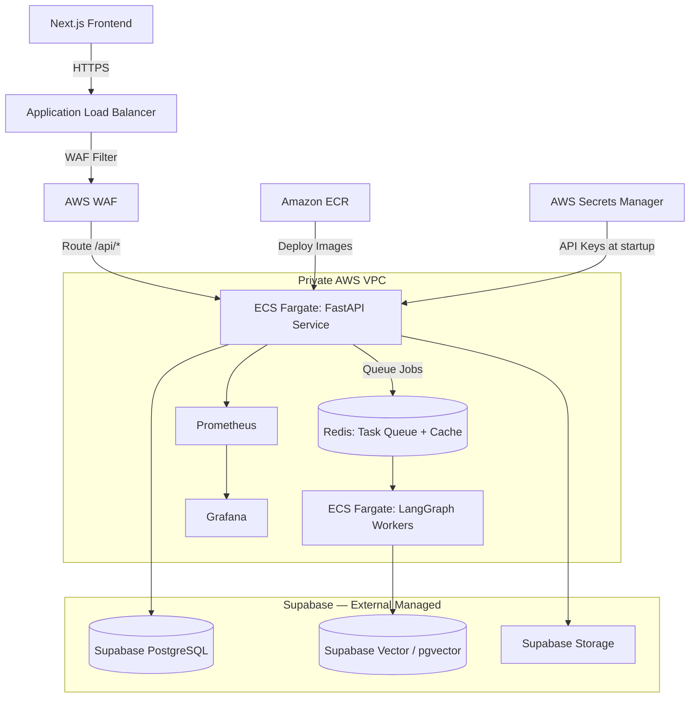

# 🛡️ AutoRAG ARCHITECT: 9-AGENT LOOP 🛡️

## 🚀 v3.0 ENGINEERING SYSTEM 🚀

---

# AutoRAG Development Notes

**Status**: v3.0 SOT Aligned | **Updated**: 10-Jul-2026 (IST)

---

# AWS Infrastructure Architecture — AutoRAG Architect v3.0

This document outlines the cloud infrastructure architecture for **AutoRAG Architect** targeting **AWS ECS Fargate**. Database, vector, and storage are provided by **Supabase** (external managed service).

---

## 1. Architectural Diagram (Logical Flow)

---

## 2. Infrastructure Component Specifications

### VPC Network Design

- **CIDR Block**: `10.0.0.0/16`
- **Subnets**:
  - 2x Public Subnets (ALB, Internet Gateway route)
  - 2x Private Subnets (ECS Fargate tasks, Redis)
- **Note**: RDS, Supabase Vector (pgvector), and S3 are removed — data services are provided by Supabase externally

### Compute: AWS ECS Fargate

- **Launch Type**: Fargate (stateless, serverless orchestration)
- **Cluster**: `autorag-prod-cluster`
- **Task CPU**: `1.0 vCPU` minimum per agent worker task
- **Task Memory**: `2 GB` RAM minimum per agent worker task
- **Auto-Scaling**: Out scale on average CPU `> 70%` or memory `> 80%`

### Data Services — Supabase (External Managed)

| Service               | Purpose                                                        |
| --------------------- | -------------------------------------------------------------- |
| **Supabase PostgreSQL** | Operational system of record — pipeline configs, audit log, evaluations |
| **Supabase Vector**   | pgvector — shared `pipeline_chunks` table, partitioned by `pipeline_version` column (Version 4.0, migration 0016 — see `docs/DB_SCHEMA.md`; supersedes the old per-pipeline `autorag_{pipeline_id}_{version}` table convention) |
| **Supabase Storage**  | Raw document ingestion + pipeline snapshots                    |

Supabase is accessed over HTTPS from ECS tasks. Connection strings are stored in **AWS Secrets Manager**.

### Cache / Queue: Redis

- **Purpose**: LangGraph checkpoint state caching, LLM/embedding response caching, job-status lookups
- **Options**: ElastiCache Redis (production) or self-hosted Redis (dev/staging)
- **No RDS, No Supabase Vector (pgvector), No ElastiCache for vector/DB** — those are handled by Supabase
- **Correction (24-Jul-2026)**: "Async task queue for LangGraph workers" (implying a real Redis-backed queue feeding a separate ECS worker service) describes target production topology, not the current implementation — async work (ingestion, evaluation) currently runs via FastAPI's in-process `BackgroundTasks`, no Redis queue or separate worker service exists yet. See `adr/005-supabase.md`'s correction note for the full investigation (R-052/R-050). Building the real queue + worker split is a Version 5 candidate.

### Monitoring: Prometheus + Grafana

- **Prometheus**: Deployed inside VPC private subnet — scrapes ECS API and worker metrics
- **Grafana**: Dashboard server — connects to Prometheus data source; serves LLMOps and system dashboards

---

## 3. Deployment Safety & Secrets

- **AWS Secrets Manager**: All credentials — Supabase connection strings, Gemini API key, KiMi API key, Cohere API key — are fetched dynamically by ECS tasks at startup. **No secrets stored in Terraform files or YAML manifests.**
- **IAM Core**: ECS tasks bound to minimal execution roles (`autorag-ecs-execution-role`) — least privilege
- **AWS WAF**: Protects ALB from injection attacks, rate limiting, geo-blocking
- **ECR**: Container images stored with immutable SHA tags — no `latest` tags in production task definitions

