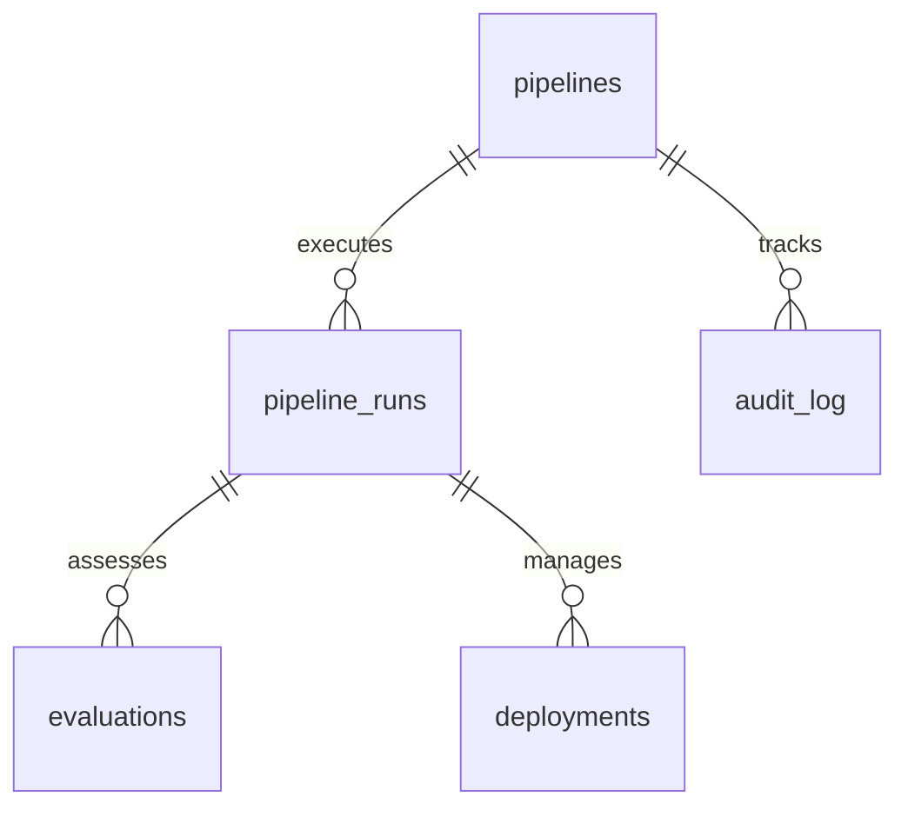

# 🛡️ AutoRAG ARCHITECT: 9-AGENT LOOP 🛡️

## 🚀 v3.0 ENGINEERING SYSTEM 🚀

---

# AutoRAG Development Notes

**Status**: v3.0 SOT Aligned | **Updated**: 10-Jul-2026 (IST)

---

# Database Schema & Models — AutoRAG Architect v3.0

This document specifies the schema definitions and vector indexing conventions for **Supabase PostgreSQL** (Operational System of Record) and **Supabase Vector / pgvector** (Vector Database).

---

## 1. Supabase PostgreSQL Schema (Relational System of Record)

All transactional, operational, and auditing data is stored in **Supabase PostgreSQL** (managed PostgreSQL).



### Critical Tables Overview

#### `pipelines`

Tracks the global configurations, chunking parameters, and embedding providers.

```sql
CREATE TABLE pipelines (
    id UUID PRIMARY KEY DEFAULT gen_random_uuid(),
    name VARCHAR(255) NOT NULL,
    version VARCHAR(50) NOT NULL,
    chunk_strategy VARCHAR(100) NOT NULL, -- Semantic, Hierarchical, Late
    embedding_model VARCHAR(255) NOT NULL, -- gemini-embedding-2
    created_at TIMESTAMP WITH TIME ZONE DEFAULT CURRENT_TIMESTAMP
);
```

#### `pipeline_runs`

Tracks individual agent loop execution instances.

```sql
CREATE TABLE pipeline_runs (
    id UUID PRIMARY KEY DEFAULT gen_random_uuid(),
    pipeline_id UUID REFERENCES pipelines(id),
    status VARCHAR(50) NOT NULL, -- running, completed, failed
    started_at TIMESTAMP WITH TIME ZONE DEFAULT CURRENT_TIMESTAMP,
    ended_at TIMESTAMP WITH TIME ZONE
);
```

#### `evaluations`

Stores the results of the 3-Layer Evaluation system (Unified Score, RAGAS, Adversarial).

```sql
CREATE TABLE evaluations (
    id UUID PRIMARY KEY DEFAULT gen_random_uuid(),
    run_id UUID REFERENCES pipeline_runs(id),
    unified_score NUMERIC(4, 3) NOT NULL, -- Weight-based score
    ragas_score JSONB, -- Context precision, Context recall, Faithfulness
    adversarial_failures INT DEFAULT 0,
    explanation TEXT,
    created_at TIMESTAMP WITH TIME ZONE DEFAULT CURRENT_TIMESTAMP
);
```

#### `audit_log` (CRITICAL RULE)

Tracks operational, security, and lifecycle mutations.

- **RULE**: **INSERT ONLY**. This table is immutable. No updates or deletions are permitted under any condition.

```sql
CREATE TABLE audit_log (
    id UUID PRIMARY KEY DEFAULT gen_random_uuid(),
    pipeline_id UUID REFERENCES pipelines(id),
    action VARCHAR(255) NOT NULL,
    actor VARCHAR(255) NOT NULL,
    payload JSONB NOT NULL,
    timestamp TIMESTAMP WITH TIME ZONE DEFAULT CURRENT_TIMESTAMP
);
```

---

## 2. Supabase Vector (pgvector) Standards

Every pipeline run requires robust vector isolation to support clean rollbacks and safe deployments.

> **Superseded 20-Jul-2026 (Version 4.0)**: the per-version physical table convention
> below was replaced by a single shared `pipeline_chunks` table (migration 0016)
> partitioned by a `pipeline_version` column — real integration testing found the
> per-version table was never actually reachable by real version increments, so
> rebuilds silently overwrote data instead of isolating versions. See
> `.claude/docs/DB_SCHEMA.md`'s "Immutable Versioned Indexes" addendum for the current,
> real architecture. Text below is preserved as historical record of the original design.

### Table Naming Convention (superseded — see note above)

Every pipeline version has its own dedicated pgvector table named:

```
autorag_{pipeline_id}_{version}
```

This naming is **frozen** — do not change without architect approval.

### Embedding Standards

- **Primary Vector Config**: Google `Gemini Embedding 2`
- **RULE**: If a pipeline's embedding model changes, a new vector table MUST be created. Mutating vectors in an existing table with a different model is strictly forbidden.
- **Metadata columns**: `chunk_id`, `source_doc_id`, `page_number`, `chunk_strategy` — mandatory on every row.

---

## 3. Data Lifecycle Policy

Governs retention, archival, deletion, and GDPR compliance for all data stores in AutoRAG Architect.

### 3.1 Retention Schedule

| Data Asset                 | Store                               | Retention                                    | Trigger                       | Owner   |
| -------------------------- | ----------------------------------- | -------------------------------------------- | ----------------------------- | ------- |
| Raw ingested documents     | Supabase Storage (`autorag-{env}-ingestion-docs`) | 90 days active; archive after  | Pipeline completion           | Infra team  |
| Chunked document artifacts | Supabase Storage (`autorag-{env}-chunks`)         | Retained for lifetime of pipeline version | Pipeline deletion    | Infra team  |
| Vector embeddings          | Supabase Vector table                             | Retained until table explicitly deleted | Pipeline version decommission | RAG team |
| `pipeline_runs` rows       | Supabase PostgreSQL                               | 1 year active; export to Parquet after | Automated monthly job          | Infra team  |
| `evaluations` rows         | Supabase PostgreSQL                               | 2 years — needed for score trend analysis | Automated annual job        | Eval team   |
| `audit_log` rows           | Supabase PostgreSQL                               | **Permanent — never deleted**          | INSERT ONLY; no archival       | Platform    |
| LangGraph checkpoints      | Supabase PostgreSQL `checkpoints`                 | Deleted 7 days after pipeline run completes | Automated cleanup job     | Agent team  |
| MLflow experiment runs     | MLflow server                                     | 1 year; pruned if score < 0.50         | Manual pruning gate            | Eval team   |
| Prometheus metrics         | Prometheus TSDB                                   | 15 days (default retention)            | Prometheus config              | Infra team  |

### 3.2 GDPR & PII Handling

| Requirement          | Implementation                                                                                                                                                                             |
| -------------------- | ------------------------------------------------------------------------------------------------------------------------------------------------------------------------------------------ |
| PII never stored raw | Custom PII Detection & Masking Functions mask all PII before any write to Supabase Storage, Supabase Vector, Supabase PostgreSQL, or LangGraph state |
| Right to erasure     | Customer data deletion request → delete Supabase Storage objects + drop Supabase Vector table for that `organization_id` + soft-delete `pipelines` rows; `audit_log` entries are retained (legal obligation) |
| Data residency       | All stores inside AWS `ap-south-1` (or region agreed with customer) — no cross-region replication of customer data                                                                         |
| PII in logs          | CloudWatch log groups have no structured PII fields; structured logging ensures PII fields are masked before any write                                                                        |
| Consent scope        | Documents ingested only after explicit API call from authenticated `organization_id` owner                                                                                                 |

### 3.3 Supabase Storage Lifecycle

Manage via Supabase dashboard or API:

- Raw ingestion docs: active 90 days → archive/delete after 365 days
- Chunk artifacts: no automatic expiry — deleted programmatically on pipeline decommission

### 3.4 Vector Table Decommission Procedure

When a pipeline version is retired:

1. Set `pipelines.status = 'decommissioned'` (soft-delete — never hard-delete)
2. Write `audit_log` entry: `action = 'pipeline_decommissioned'`
3. Delete that version's rows from the shared `pipeline_chunks` table
   (`WHERE pipeline_id = :id AND pipeline_version = :version`) — Version 4.0,
   migration 0016; there is no longer a separate physical table to drop
4. Delete Supabase Storage prefix: `autorag-{env}-chunks/{pipeline_id}/{version}/`
5. Retain `pipeline_runs`, `evaluations` rows per retention schedule above
6. Do NOT delete `audit_log` entries for the decommissioned pipeline

